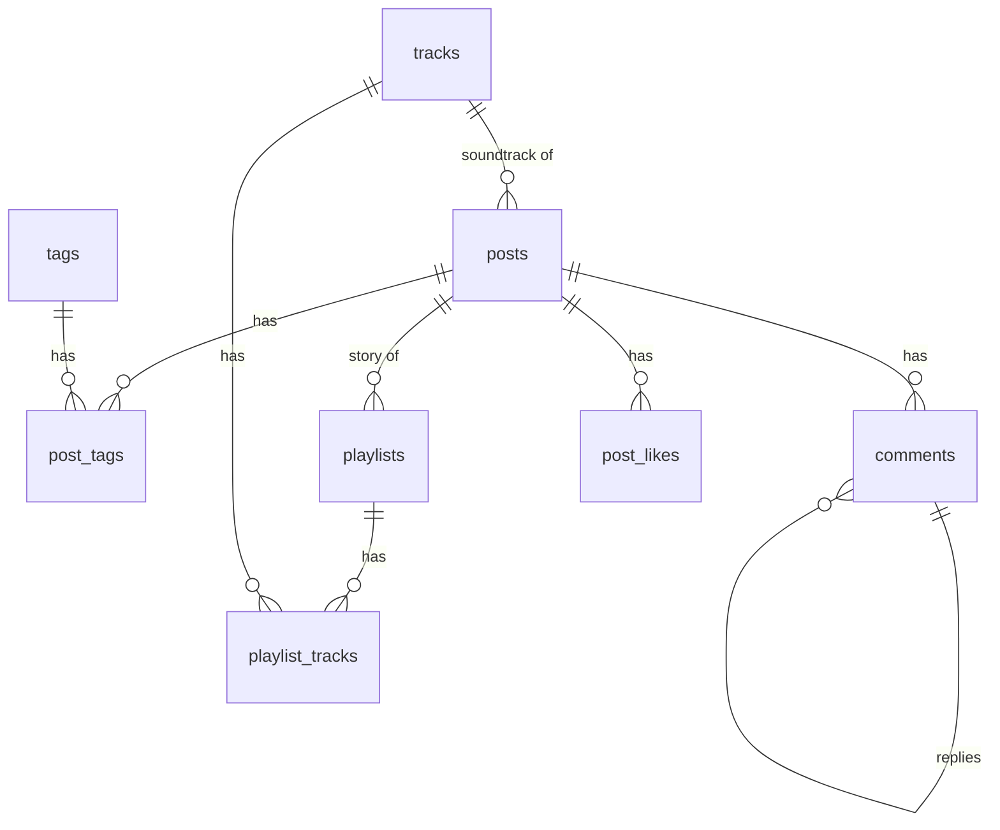
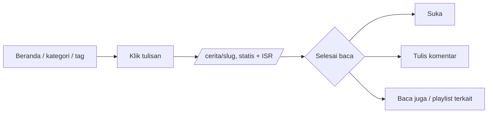
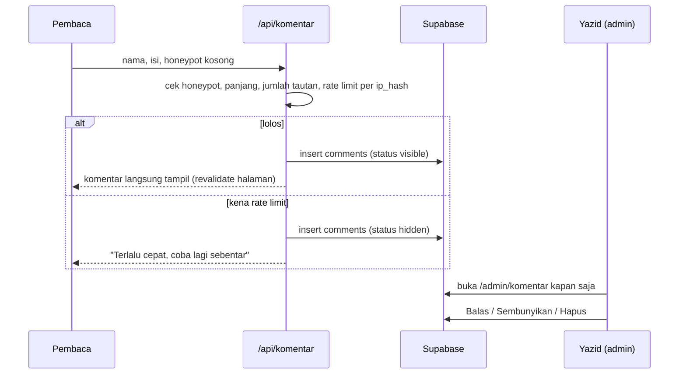
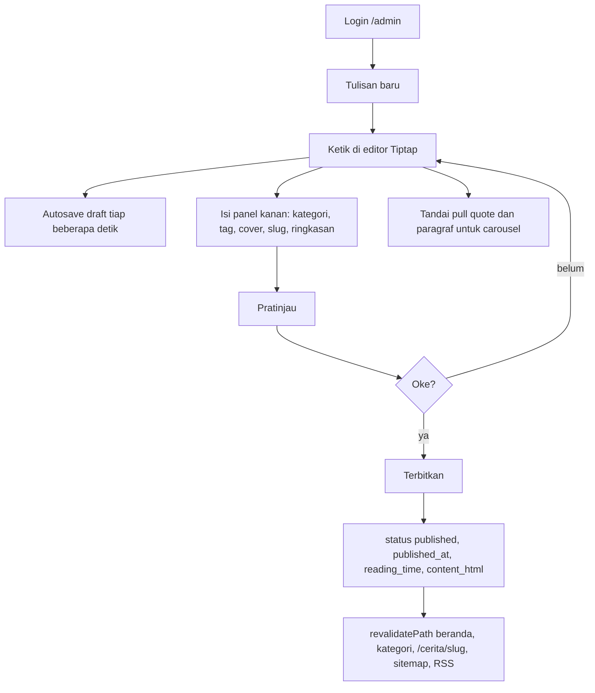
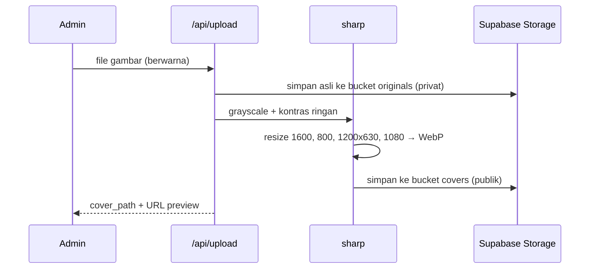
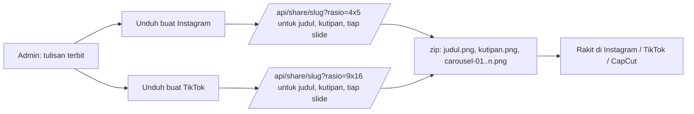
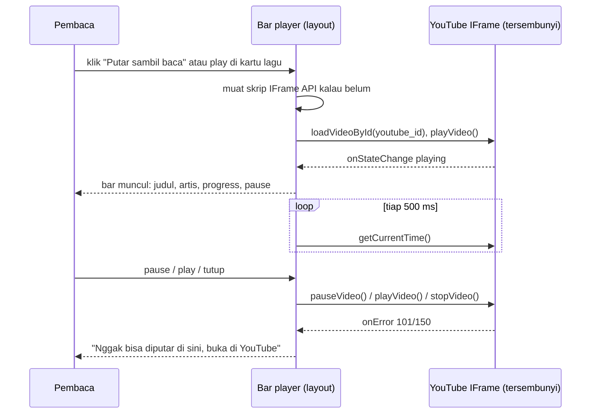

# Yacuap

Dokumen produk, desain, dan rencana pengerjaan. Versi 1, 30 September 2026.

Mockup visual: https://claude.ai/artifact/X8UPH9YjPAANsvjnBfcarJ

---

## 1. Ringkasan

Yacuap (dari "Yazid" dan "cuap-cuap") adalah website pribadi Yazid Syafiq Irsyad untuk menuangkan cerita: tulisan tentang musik, hasil pemikiran, dan hal-hal absurd. Selain tulisan panjang ala Medium, website ini juga jadi tempat mengatur dan membagikan playlist musik. Setiap tulisan bisa diubah otomatis jadi kartu gambar untuk Instagram dan TikTok.

Penulisnya satu orang. Pembaca tidak perlu akun, dan bisa berkomentar secara anonim. Komentar langsung tampil.

### Tujuan

- Punya tempat menulis yang nyaman, fokus ke teks, tanpa gangguan.
- Playlist punya "cerita" per lagu, bukan sekadar daftar.
- Konten bisa dibagikan ke Instagram dan TikTok tanpa screenshot manual.
- Tampilan konsisten monokrom, termasuk semua cover foto.

### Bukan tujuan (v1)

- Multi-penulis atau kolaborasi.
- Akun pembaca, login sosial, profil.
- Newsletter, notifikasi email.
- Integrasi Spotify API otomatis (cukup link manual).
- Pembuatan video otomatis untuk TikTok (cukup gambar diam).

---

## 2. Prinsip desain

- **Monokrom penuh.** Latar abu sangat terang, tinta hampir hitam, teks meta abu, tanpa warna aksen. Cover foto ikut diubah ke grayscale saat upload, jadi tidak ada satu pun elemen berwarna di seluruh website.
- **Teks adalah bintangnya.** Kolom baca 680px, serif untuk badan tulisan, ukuran 20 sampai 21px, line-height longgar.
- **Hierarki dari ukuran dan ketebalan**, bukan warna. Tombol utama hitam pekat, tombol sekunder outline.
- **UI diam, konten bicara.** Chip kategori, garis, dan tombol harus terasa mundur dibanding judul dan cover.

### Token warna

| Token | Nilai | Dipakai untuk |
|---|---|---|
| `bg` | `#f4f4f4` | Latar halaman |
| `surface` | `#ffffff` | Kartu, form, editor |
| `ink` | `#111111` | Teks utama, tombol utama, sidebar admin |
| `muted` | `#6a6a6a` | Tanggal, waktu baca, label, placeholder |
| `line` | `#dcdcdc` | Garis pembatas, border kartu |
| `border-strong` | `#c9c9c9` | Border input |
| `cover` | `#c4c4c4` | Placeholder cover saat gambar belum ada |
| `ink-soft` | `#2e2e2e` | Item aktif di sidebar admin, tombol Setujui |

Kontras `muted` di atas `bg` sekitar 5:1, aman untuk teks kecil.

### Tipografi

| Peran | Font | Catatan |
|---|---|---|
| Judul, wordmark | Fraunces | Weight 500, wordmark italic |
| Badan tulisan | Newsreader | 20 sampai 21px, line-height 1.7 |
| Label UI, meta, tombol | Instrument Sans | 13 sampai 15px, label uppercase dengan letter-spacing 0.08 sampai 0.1em |

Semua dari Google Fonts, dimuat lewat `next/font` supaya tidak ada layout shift.

### Logo

Logo sudah jadi, dibuat Yazid: siluet mulut dari samping yang terbuka, membentuk Y, dengan tulisan "cuap" di dalam mulut dan tiga garis suara. Wordmark "Yacuap" memakai sans bulat tebal. File sumber gabungan di `docs/logo.png`, aset terpisah (PNG transparan, dipotong dari sumber) di `docs/logo/`:

| File | Dipakai untuk |
|---|---|
| `yacuap-mark.png`, `yacuap-mark-putih.png` | Simbol saja: header di HP, bar player, pojok kartu share, watermark |
| `yacuap-wordmark.png`, `yacuap-wordmark-putih.png` | Nama saja, kalau simbol sudah ada di dekatnya |
| `yacuap-lockup-horizontal.png` | Header desktop, footer |
| `yacuap-lockup-vertikal.png` | Halaman Tentang, kartu share versi judul, OG image |
| `yacuap-icon-kotak.png` | Ikon aplikasi (apple-touch-icon, PWA), avatar |
| `yacuap-icon-bulat.png` | Avatar Instagram/TikTok |

Yang masih perlu: versi vektor (SVG) supaya tajam di semua ukuran dan bisa diwarnai lewat CSS. Kalau file sumbernya ada (AI/SVG), taruh di `docs/logo/`. Kalau tidak, di Phase 0 di-trace dari PNG. Favicon 16 dan 32 px dibuat dari `yacuap-icon-kotak.png`.

Catatan tipografi: wordmark logo memakai sans bulat, sementara UI memakai Fraunces dan Instrument Sans. Ini disengaja: logo tampil sebagai gambar, bukan teks, jadi tidak perlu font tambahan. Judul situs di header adalah gambar lockup, bukan teks Fraunces.

### Tombol

Panjang dan lebar tombol selalu seragam di seluruh situs. Lebar tidak mengikuti panjang tulisan.

| Jenis | Ukuran | Dipakai untuk |
|---|---|---|
| `md` (bawaan) | 236 x 44 px | Tombol utama halaman, misalnya dua tombol di hero |
| `sm` | 160 x 40 px | Tombol kecil di dalam kartu atau baris data |
| `block` | selebar formulir, tinggi sesuai ukurannya | Tombol di dalam formulir, misalnya Masuk |

Aturan turunannya: tombol yang berdampingan selalu sama besar; tulisan tombol harus muat (paling panjang sekitar 28 karakter untuk `md`, 17 untuk `sm`); lebar dan tinggi tidak boleh ditimpa per tombol. Semua tombol dibuat lewat `components/ui/button.tsx` (`Button` atau `buttonClass`), dan ukuran baru hanya boleh ditambahkan di file itu.

### Kategori

Tiga kategori tetap, dibedakan lewat gelap-terang chip, bukan warna:

| Kategori | Slug | Chip |
|---|---|---|
| Musik | `musik` | Hitam pekat, teks putih |
| Pikiran | `pikiran` | Abu muda, teks hitam |
| Absurd | `absurd` | Putih, outline hitam |

---

## 3. Fitur dan requirement

### 3.1 Tulisan (posts)

- Editor ala Medium berbasis Tiptap: heading H2, tebal, miring, kutipan, tautan, gambar, embed lagu (Spotify/YouTube), pemisah.
- Konten disimpan sebagai JSON Tiptap, dirender ke HTML di server saat dibaca.
- Setiap tulisan punya: judul, slug (otomatis dari judul, bisa diedit), ringkasan, cover, kategori (wajib satu), tag (opsional, banyak), status draft/published, tanggal terbit, waktu baca (dihitung otomatis).
- Satu kalimat bisa ditandai sebagai **kutipan andalan** (`pull_quote`) untuk dipakai di kartu share.
- Autosave draft setiap beberapa detik.
- Pratinjau sebelum terbit.
- Halaman baca: kolom 680px, judul, subjudul, baris penulis, cover, isi, tag, tombol Suka, komentar, "Baca juga".
- Suka (clap) anonim: satu klik per pengunjung per tulisan, disimpan di localStorage plus counter di database.

### 3.2 Kategori dan tag

- Kategori: tiga nilai tetap, enum di database.
- Tag: bebas, tabel sendiri, relasi many-to-many dengan tulisan.
- Halaman kategori `/musik`, `/pikiran`, `/absurd`, dan halaman tag `/tag/[slug]`.

### 3.3 Playlist

- Playlist punya: nama, slug, deskripsi, cover (monokrom), link Spotify, link YouTube Music, status draft/published.
- Lagu di playlist: judul, artis, album, durasi, link, urutan, dan **catatan** (kenapa lagu ini masuk). Catatan opsional.
- Playlist bisa dikaitkan ke satu tulisan ("Cerita di balik playlist ini") dan sebaliknya.
- Beranda menampilkan satu playlist yang di-highlight ("Lagi diputar").

### 3.4 Komentar anonim, langsung tampil

- Form: nama (wajib), komentar (wajib), email (opsional, tidak ditampilkan), honeypot tersembunyi.
- Komentar **langsung tampil** begitu dikirim, tanpa approval. Halaman baca di-revalidate saat itu juga.
- Balasan satu level: pembaca bisa membalas komentar, tidak bisa membalas balasan. Penulis bisa membalas dari admin dan balasannya diberi label "Penulis".
- Anti-spam tetap ada karena tidak ada penyaring manusia di depan: honeypot, rate limit per IP (3 komentar per 5 menit), panjang maksimal 2000 karakter, maksimal 1 tautan. Komentar yang kena rate limit otomatis disembunyikan, bukan ditolak, supaya kamu masih bisa memeriksanya.
- Admin `/admin/komentar`: daftar terbaru, tab Semua / Disembunyikan, aksi Balas, Sembunyikan, Hapus. Badge di sidebar menunjukkan jumlah komentar baru sejak terakhir dibuka.

### 3.5 Cover monokrom

- Upload dari admin lewat route handler Next.js, bukan langsung ke Storage dari browser.
- Server memproses dengan `sharp`: grayscale, sedikit tambahan kontras, resize ke beberapa ukuran, konversi ke WebP.
- Ukuran yang dihasilkan: `cover-1600` (halaman baca), `card-800` (daftar dan kartu), `og-1200x630` (preview link), plus `share-1080` untuk kartu Instagram/TikTok.
- File asli berwarna disimpan di bucket privat `originals`, hanya untuk cadangan. Versi monokrom di bucket publik `covers`.
- **Semua gambar** lewat pipeline yang sama, bukan hanya cover: gambar yang disisipkan di dalam isi tulisan, artwork lagu dari YouTube, cover playlist, dan avatar. Tidak ada jalur upload yang melewati grayscale.

### 3.6 Kartu bagikan (share cards)

- Dibuat otomatis dari data tulisan dengan `ImageResponse` dari `next/og`, memakai palet dan font yang sama dengan website.
- Tiga jenis kartu dikali dua rasio:

| Jenis | 4:5 (1080 x 1350) Instagram | 9:16 (1080 x 1920) TikTok, IG Story |
|---|---|---|
| Judul | cover + kategori + judul + wordmark | sama, area atas dan bawah dikosongkan |
| Kutipan | tanda kutip besar + `pull_quote` + judul | sama, padding kanan dan bawah lebih besar |
| Carousel | slide 1 judul, slide tengah paragraf, slide akhir ajakan baca | sama |

- Slide carousel dibuat dari paragraf yang ditandai di editor (`share_paragraphs`), maksimal 8 slide.
- Admin: tombol "Unduh buat Instagram" dan "Unduh buat TikTok", masing-masing menghasilkan zip.
- OG image memakai template kartu judul pada rasio 1200 x 630.

### 3.7 Admin

- Login hanya untuk satu akun lewat Supabase Auth (email + password, atau magic link).
- Menu: Tulisan, Playlist, Komentar (dengan badge komentar baru), Keluar.
- Semua halaman admin di bawah `/admin`, dilindungi middleware.

### 3.9 Pemutar musik di dalam cerita

Tulisan bisa punya lagu yang diputar sambil dibaca. Sumber audionya YouTube, videonya tidak ditampilkan, kontrolnya tombol sendiri yang monokrom.

Keputusan ini diambil dengan sadar: menyembunyikan player YouTube melanggar syarat layanan API YouTube (player wajib terlihat minimal 200 x 200 px dan audio tidak boleh dipisah dari video). Risiko untuk website pribadi kecil, tapi ada. Lihat bagian 9.

Cara kerja:

- Satu instance YouTube IFrame Player dibuat sekali di root layout, ditaruh di luar layar (posisi fixed, 1 x 1 px, opacity 0). Jangan pakai `display: none`, player tidak jalan. Parameter `playsinline=1` wajib supaya iOS tidak membuka player layar penuh.
- Semua kontrol lewat IFrame API resmi: `playVideo`, `pauseVideo`, `seekTo`, `getCurrentTime`, `getDuration`. Progress di-poll tiap 500 ms saat sedang diputar.
- Pemutaran hanya dimulai dari klik pengguna (browser melarang autoplay). Tombolnya "Putar sambil baca".
- Hanya satu lagu yang diputar pada satu waktu. Memutar lagu lain mengganti yang sedang jalan.

Dua titik masuk:

1. **Lagu pengiring tulisan.** Satu lagu ditempel ke tulisan dari admin. Di halaman baca, di bawah baris penulis, ada tombol "Putar sambil baca" dengan judul dan artis. Diklik, muncul **bar player** di bawah layar: play/pause, judul, artis, garis progress, waktu, tombol tutup. Bar hidup di layout, jadi lagu tetap jalan saat scroll atau pindah halaman.
2. **Kartu lagu di dalam tulisan.** Node Tiptap `trackCard` menampilkan artwork monokrom, judul, artis, dan tombol play/pause yang mengirim lagu ke bar player yang sama. Dipakai juga di halaman playlist, tiap lagu punya tombol play.

Menambah lagu di admin: tempel URL YouTube, server mengambil judul dan thumbnail lewat oEmbed (tanpa API key), thumbnail lewat pipeline grayscale, artis dan judul bisa diedit manual karena judul video YouTube sering berantakan.

Yang harus ditangani:

- Video yang tidak boleh di-embed (error 101 / 150): bar menampilkan "Nggak bisa diputar di sini" dengan tautan ke YouTube.
- Iklan: YouTube bisa memutar iklan di player embed. Karena player tersembunyi, pembaca bisa mendengar audio iklan tanpa melihatnya. Tampilkan status "iklan" di bar kalau state player menunjukkan itu, atau minimal jangan tampilkan progress yang loncat.
- HP: iOS Safari dan Chrome Android menjeda iframe saat tab pindah ke belakang atau layar mati. Ini tidak bisa diakali dari sisi website. Bar player cukup menampilkan tombol play lagi.
- Skrip IFrame API dimuat malas, hanya saat pengguna pertama kali menekan play, supaya halaman baca tetap ringan.

### 3.8 SEO dan lain-lain

- Metadata per halaman, OG image otomatis, sitemap, RSS.
- Halaman Tentang sederhana.
- Rendering: halaman publik statis dengan revalidasi saat ada perubahan (ISR + `revalidatePath` dari admin).

---

## 4. Arsitektur dan stack

| Lapisan | Pilihan | Alasan |
|---|---|---|
| Framework | Next.js 16 (selalu versi terbaru), App Router, TypeScript, Turbopack | Server Components untuk halaman baca yang cepat, route handler untuk upload dan gambar |
| Styling | Tailwind CSS v4 | Token warna sebagai CSS variables, cepat dikerjakan |
| Database | Supabase Postgres | Relasional, RLS, cukup satu proyek |
| Auth | Supabase Auth | Satu akun admin |
| Storage | Supabase Storage | Bucket `covers` publik, `originals` privat |
| Editor | Tiptap | Rasa Medium, output JSON, mudah diperluas (embed lagu) |
| Gambar | sharp | Grayscale, resize, WebP di server |
| Share cards | `next/og` (Satori) | Render komponen jadi PNG di server |
| Zip | `fflate` atau `jszip` | Bundel kartu share |
| Deploy | Vercel | Cocok dengan Next.js, sharp tersedia |

Struktur folder yang direncanakan:

```
app/
  (public)/
    page.tsx                  beranda
    [kategori]/page.tsx       musik, pikiran, absurd
    cerita/[slug]/page.tsx    halaman baca
    playlist/page.tsx
    playlist/[slug]/page.tsx
    tag/[slug]/page.tsx
    tentang/page.tsx
  admin/
    layout.tsx                sidebar + proteksi
    tulisan/...
    playlist/...
    komentar/page.tsx
  api/
    upload/route.ts           pipeline cover monokrom
    komentar/route.ts         insert komentar + rate limit
    share/[slug]/route.ts     kartu share (query: jenis, rasio, slide)
    og/[slug]/route.ts        OG image
components/
lib/
  supabase/                   client server, client browser, tipe
  tiptap/                     ekstensi dan renderer
  image/                      pipeline sharp
  share/                      template kartu
supabase/
  migrations/
docs/
  PRD.md
```

---

## 5. Model data



### posts

| Kolom | Tipe | Catatan |
|---|---|---|
| id | uuid pk | |
| title | text | |
| slug | text unique | |
| excerpt | text | |
| content | jsonb | dokumen Tiptap |
| content_html | text | hasil render, cache |
| cover_path | text | path di bucket `covers`, tanpa ukuran |
| category | enum `musik` `pikiran` `absurd` | |
| status | enum `draft` `published` | |
| published_at | timestamptz | null saat draft |
| reading_time | int | menit, dihitung saat simpan |
| pull_quote | text | kalimat untuk kartu kutipan |
| share_paragraphs | jsonb | array teks untuk carousel |
| like_count | int default 0 | |
| created_at, updated_at | timestamptz | |

### tags, post_tags

- `tags(id, name, slug unique)`
- `post_tags(post_id, tag_id)` primary key gabungan

### playlists

| Kolom | Tipe | Catatan |
|---|---|---|
| id | uuid pk | |
| name, slug unique, description | text | |
| cover_path | text | |
| spotify_url, youtube_url | text | opsional |
| post_id | uuid fk posts | opsional, cerita di balik playlist |
| status | enum draft/published | |
| is_featured | bool | yang tampil di beranda |
| created_at, updated_at | timestamptz | |

### playlist_tracks

| Kolom | Tipe | Catatan |
|---|---|---|
| playlist_id | uuid fk playlists | pk gabungan |
| track_id | uuid fk tracks | pk gabungan |
| note | text | kenapa lagu ini masuk |
| position | int | |

### tracks

Dipakai bersama oleh lagu pengiring tulisan, kartu lagu di dalam tulisan, dan playlist.

| Kolom | Tipe | Catatan |
|---|---|---|
| id | uuid pk | |
| title, artist, album | text | bisa diedit manual setelah oEmbed |
| youtube_id | text unique | 11 karakter |
| duration_seconds | int | dari IFrame API saat pertama diputar, atau diisi manual |
| artwork_path | text | thumbnail YouTube yang sudah digrayscale, bucket `covers` |
| spotify_url | text | opsional, tautan "Dengar di Spotify" |
| created_at | timestamptz | |

`posts` mendapat kolom `soundtrack_track_id uuid fk tracks` (opsional). Node `trackCard` di dalam konten Tiptap menyimpan `track_id`. `playlist_tracks` menjadi tabel penghubung: `playlist_id`, `track_id`, `position`, `note`; kolom judul, artis, album, durasi, url pindah ke `tracks`.

### comments

| Kolom | Tipe | Catatan |
|---|---|---|
| id | uuid pk | |
| post_id | uuid fk | |
| parent_id | uuid fk comments | null untuk komentar utama |
| author_name | text | |
| author_email | text | opsional, tidak pernah dikirim ke klien publik |
| body | text | |
| status | enum `visible` `hidden` | default visible; `hidden` untuk yang disembunyikan admin atau kena rate limit |
| is_author | bool | true untuk balasan Yazid |
| ip_hash | text | untuk rate limit, bukan IP mentah |
| created_at | timestamptz | |

### post_likes

- `post_likes(post_id, visitor_id, created_at)`, `visitor_id` dari cookie acak. Cukup untuk mencegah dobel sederhana.

### Row Level Security

| Tabel | Publik (anon) | Admin (authenticated) |
|---|---|---|
| posts | select where status = published | semua |
| tags, post_tags | select | semua |
| playlists, playlist_tracks | select where playlist published | semua |
| tracks | select | semua |
| comments | select where visible; insert hanya lewat route handler | semua |
| post_likes | insert | semua |

Insert komentar dan like tetap lewat route handler (bukan langsung dari browser ke Supabase) supaya rate limit dan honeypot jalan di server.

### Storage

| Bucket | Akses | Isi |
|---|---|---|
| `covers` | publik, baca | `{postId}/cover-1600.webp`, `card-800.webp`, `og.webp`, `share-1080.webp`; juga gambar isi tulisan |
| `originals` | privat | file asli berwarna, nama sama |

---

## 6. Flow

### 6.1 Pembaca membaca tulisan



### 6.2 Komentar



### 6.3 Menulis dan menerbitkan



### 6.4 Upload cover monokrom



### 6.5 Kartu bagikan



### 6.6 Playlist

```mermaid
flowchart TD
  A[Admin: playlist baru] --> B[Nama, deskripsi, cover, link Spotify/YouTube]
  B --> C[Tambah lagu satu per satu, catatan opsional, urutkan]
  C --> D[Kaitkan ke tulisan, opsional]
  D --> E[Terbitkan, opsional jadikan featured]
  E --> F[/playlist/slug dan kartu Lagi diputar di beranda]
```

### 6.7 Pemutar musik



---

## 7. Pembagian phase

Tiap phase menghasilkan sesuatu yang bisa dilihat dan dipakai. Urutannya dibuat supaya kamu bisa mulai menulis sedini mungkin.

### Phase 0. Fondasi

Target: proyek jalan lokal, terhubung ke Supabase, sistem desain terpasang.

- Init Next.js + TypeScript + Tailwind, `next/font` untuk Fraunces, Newsreader, Instrument Sans.
- Token warna sebagai CSS variables, komponen dasar: tombol, chip, input, kartu, layout kolom 680.
- Proyek Supabase, env, client server dan browser, tipe hasil generate.
- Migration awal: enum, tabel `posts`, `tags`, `post_tags`, RLS, bucket `covers` dan `originals`.
- Auth admin: satu akun, middleware proteksi `/admin`, halaman login, keluar.

Selesai kalau: bisa login ke `/admin` kosong, halaman publik menampilkan layout dan font yang benar.

### Phase 1. Menulis dan membaca

Target: bisa menulis, menerbitkan, dan membaca tulisan dari awal sampai akhir.

- Editor Tiptap dengan toolbar mengambang, autosave, slug otomatis, waktu baca.
- Panel kanan: kategori, tag, slug, ringkasan (cover menyusul di phase 3, sementara pakai placeholder).
- Pratinjau dan Terbitkan, `revalidatePath`.
- Halaman baca `/cerita/[slug]` sesuai mockup, renderer JSON ke HTML.
- Beranda, halaman kategori, halaman tag.
- Suka anonim.
- Daftar tulisan di admin: filter draft/published, edit, hapus.

Selesai kalau: satu tulisan asli bisa diterbitkan dan dibaca di HP dan desktop.

### Phase 2. Playlist

Target: playlist dengan catatan per lagu, tampil di beranda dan halaman sendiri.

- Migration `tracks`, `playlists`, `playlist_tracks`, kolom `soundtrack_track_id` di `posts`, RLS.
- Admin: tambah lagu dari URL YouTube (oEmbed, thumbnail grayscale), edit judul dan artis.
- Pemutar musik: YouTube IFrame tersembunyi di root layout, bar player di bawah layar, tombol "Putar sambil baca", node `trackCard` di editor dengan play/pause.
- Admin: CRUD playlist, tambah dan urutkan lagu (drag), catatan per lagu, kaitkan ke tulisan, featured.
- Halaman `/playlist` dan `/playlist/[slug]`.
- Kartu "Lagi diputar" di beranda, kartu "Cerita di balik playlist ini".
- Embed lagu di dalam tulisan (Tiptap node untuk Spotify/YouTube).

Selesai kalau: satu playlist asli terbit, dan satu tulisan bisa diputar lagunya sambil dibaca, di desktop dan HP.

### Phase 3. Cover monokrom dan gambar

Target: semua gambar lewat pipeline grayscale.

- Route `/api/upload` dengan sharp: grayscale, kontras, resize, WebP, simpan asli ke `originals`.
- Komponen upload cover di panel kanan editor, dengan preview.
- **Semua gambar** lewat pipeline yang sama, bukan hanya cover: gambar yang disisipkan di dalam isi tulisan, artwork lagu dari YouTube, cover playlist, dan avatar. Tidak ada jalur upload yang melewati grayscale.
- Komponen `<Cover>` yang memilih ukuran sesuai konteks.
- OG image dasar dari `og.webp`.

Selesai kalau: upload foto berwarna, hasil di website dan di preview link WhatsApp sama-sama monokrom.

### Phase 4. Komentar

Target: pembaca bisa komentar tanpa akun dan langsung tampil, kamu tetap bisa membersihkan.

- Migration `comments`, RLS.
- Form komentar di halaman baca, honeypot, rate limit, batas panjang dan tautan di `/api/komentar`.
- Daftar komentar dengan balasan satu level, label "Penulis".
- Admin `/admin/komentar`: daftar terbaru, tab Semua / Disembunyikan, aksi Balas / Sembunyikan / Hapus, badge komentar baru di sidebar.

Selesai kalau: komentar dari HP orang lain langsung tampil, dan bisa disembunyikan dari admin.

### Phase 5. Kartu bagikan

Target: enam output gambar per tulisan, tinggal unduh.

- Di editor: tandai `pull_quote` dan `share_paragraphs`.
- Template `next/og`: judul, kutipan, carousel, masing-masing untuk 4:5 dan 9:16, sesuai mockup.
- Route `/api/share/[slug]` dengan parameter jenis, rasio, nomor slide.
- Tombol "Unduh buat Instagram" dan "Unduh buat TikTok" yang menghasilkan zip.
- OG image dipindah ke template kartu judul 1200 x 630.

Selesai kalau: zip terunduh, dibuka di HP, dan langsung bisa diunggah tanpa diedit.

### Phase 6. Poles dan rilis

- Halaman Tentang, sitemap, RSS, metadata lengkap, 404.
- Aksesibilitas: fokus keyboard, kontras, alt text cover (dari judul).
- Performa: cek Lighthouse halaman baca, target skor 90 ke atas.
- Deploy ke Vercel, domain, env produksi, backup database otomatis dari Supabase.

Selesai kalau: domain hidup, satu tulisan dan satu playlist terbit di produksi.

---

## 8. Keputusan yang sudah diambil

| Topik | Keputusan |
|---|---|
| Tema | Monokrom abu, tanpa aksen warna |
| Cover | Diubah grayscale di server saat upload, asli disimpan privat |
| Komentar | Anonim, langsung tampil tanpa approval, satu level balasan, admin bisa sembunyikan atau hapus |
| Playlist | Manual di database sendiri, link Spotify/YouTube opsional |
| Share cards | Dibuat otomatis, 3 jenis x 2 rasio, unduh zip |
| Konten Instagram/TikTok | Gambar diam saja, video dirakit manual |
| Musik di cerita | Sumber YouTube, video disembunyikan, kontrol sendiri lewat IFrame API |
| Nama | Yacuap, tagline "Cuap-cuap Yazid Syafiq Irsyad. Boleh didengar, boleh diabaikan." Folder repo tetap `Celotehan` |
| Bahasa UI | Indonesia |

## 9. Masih terbuka dan risiko yang diterima

- **Player YouTube tersembunyi melanggar syarat layanan API YouTube.** Diterima secara sadar untuk website pribadi. Kalau suatu saat embed diblokir, cadangannya adalah preview 30 detik dari iTunes Search API dengan player yang sama (kolom `source` bisa ditambah ke `tracks`).
- **Audio berhenti di HP saat layar mati.** Batasan browser, tidak bisa diakali.
- **Audio iklan bisa terdengar tanpa terlihat.** Ditangani lewat status di bar player.

- Nama domain (kandidat: yacuap.id, yacuap.com).
- Perlu analytics atau tidak (kalau ya, sarannya yang tanpa cookie seperti Plausible atau Umami).
- Apakah "Suka" ditampilkan angkanya ke publik atau hanya ke admin.

---

## 10. Konvensi kerja

### Semua data dari Supabase

Keputusan 10 Oktober 2026: semua data situs (tulisan, playlist, ocehan, komentar, suka, profil, media sosial) hanya berasal dari Supabase. Tidak ada data contoh, daftar cadangan, atau isi yang ditanam di kode untuk dipakai saat tabel kosong atau Supabase gagal; dalam keadaan itu halaman menampilkan keterangan kosong. Kalau penulis minta data dummy, masukkan ke tabel Supabase (lewat admin atau `supabase db query --linked`), jangan ke kode. Yang boleh tetap di kode hanya konfigurasi dan copy antarmuka: nama situs dan tagline (`lib/site.ts`), teks hero, judul bagian, bagian Oknumnya, halaman Tentang, daftar platform media sosial yang dikenal (`lib/platforms.ts`), menu. Yang sudah dibersihkan hari itu: seratus ocehan awal (tabel, kode, dan migration pengosong) serta daftar media sosial cadangan di `lib/site.ts`.

### Git dan GitHub

- Semua commit dan pull request atas nama identitas git Yazid saja (`Yazid Syafiq Irsyad`, `irsyadyazidsyafiq@gmail.com`). Tidak ada trailer `Co-Authored-By` atau catatan "generated with" dari asisten mana pun.
- Branch utama `main`. Kerja per phase di branch `phase-N-nama`, digabung ke `main` lewat PR atau merge lokal.
- Pesan commit bahasa Indonesia, singkat, kalimat perintah: "tambah pipeline cover monokrom".
- File rahasia (`.env.local`, kunci service role) tidak pernah masuk repo. `.env.example` berisi nama variabel saja.

### Deploy

- Sementara di Vercel, project dihubungkan ke repo GitHub, deploy otomatis dari `main`, preview dari PR.
- Domain sendiri menyusul. Semua URL absolut (OG image, sitemap, RSS, kartu share) dibaca dari satu variabel `NEXT_PUBLIC_SITE_URL`, jadi pindah domain cukup ganti satu env.
- Kode QR di kartu bagikan **tidak** berisi domain situs, karena gambar yang sudah diunggah tidak bisa diubah. Isinya `NEXT_PUBLIC_QR_BASE_URL` + `/r/<slug>`, yaitu `https://yazidsyafiq.github.io/yacuap/r/<slug>`: halaman pengalih statis di GitHub Pages dari folder `qr/` repo ini, dipasang oleh `.github/workflows/qr-pages.yml` (menyalin `index.html` jadi `404.html`, karena GitHub Pages menyajikan `404.html` untuk alamat yang tidak ada, jadi `/r/<slug>` ditangani di situ). Pages gratis hanya untuk repo publik, jadi repo `yacuap` dijadikan publik (keputusan 10 Oktober 2026; `.env.local` tidak pernah masuk repo). Sekali saja di GitHub: Settings > Pages > Source "GitHub Actions". Alamat tetapnya memuat nama repo, jadi repo tidak boleh diganti nama. Halaman itu melempar ke `TUJUAN/tulisan/<slug>`; pindah domain berarti mengubah `TUJUAN` di `qr/index.html` dan `NEXT_PUBLIC_SITE_URL`, sedangkan `NEXT_PUBLIC_QR_BASE_URL` tidak boleh berganti setelah kartu pertama disebar. Aplikasi sendiri juga mengalihkan `/r/<slug>` ke `/tulisan/<slug>` (`next.config.ts`), jadi alamat situs pun bisa dipakai sebagai alamat tetap kalau mau. Keputusan 10 Oktober 2026.
- Supabase paket gratis menjeda project yang tidak disentuh seminggu. Supaya tidak terjadi, Vercel Cron (`vercel.json`) memanggil `/api/ping` sekali sehari; rute itu menghitung baris `posts` lewat klien publik, jadi benar-benar menyentuh database, bukan cuma halaman statis. Paket Hobby Vercel membatasi cron sekali sehari dan jamnya tidak persis, cukup untuk ini. Ditambahkan 10 Oktober 2026.
- Supabase: **satu project untuk pengembangan dan produksi**, keputusan 30 September 2026. URL dan publishable key sama di laptop dan di Vercel. Konsekuensinya: perubahan data dari laptop langsung tampil di situs, dan `npm run db:push` langsung mengubah database produksi. Migration yang sudah di-push tidak boleh diedit, selalu buat file baru.

---

## 11. Status pengerjaan

### Banyak playlist dan chart mingguan, 10 Oktober 2026

Mockup disetujui penulis, kanvasnya di https://claude.ai/artifact/ErnKugWk9Xt8gRCgzNvZBw (baris 1 layout final beranda, baris 4 opsi yang dipertimbangkan; Opsi C yang dipilih). Ini membatalkan keputusan "hanya satu playlist" dari 30 September 2026. Dikerjakan hari itu juga, lalu direvisi dua kali setelah dilihat penulis.

**Model (revisi kedua, final): chart dan playlist benar-benar terpisah.** Playlist tidak bisa jadi chart. Chart adalah entitas sendiri yang selalu berisi paling banyak 20 lagu (`CHART_SIZE` di `lib/chart.ts`). Lagu (`tracks`) dipakai bersama: lagu di chart bisa ditambahkan ke playlist mana pun, lagu di playlist bisa ditambahkan ke chart, dan keduanya bisa menambah lagu baru dari tautan YouTube. Tidak ada konten (kartu bagikan) per lagu; kartu bagikan hanya untuk chart dan playlist. Arsip chart mingguan **tidak disimpan**: "Mulai minggu baru" menimpa (keputusan sementara).

- **Data.** `20261010010000_banyak_playlist.sql` (revisi pertama, sudah dibatalkan isinya) lalu `20261010020000_chart_terpisah.sql`: tabel `chart` satu baris (`id boolean = true`, `title`, `description`, `chart_from`, `chart_to`) dan `chart_tracks` (`track_id` pk, `position` 1 sampai 20, `last_position` kosong = baru, `weeks_on_chart` mulai 1, `note`). Isi chart contoh dipindahkan dari playlist yang tadinya ditandai; kolom `is_featured`, `chart_from`, `chart_to` di `playlists` dan `last_position`, `weeks_on_chart` di `playlist_tracks` dihapus. RLS: publik membaca, admin mengelola.
- **Pengambil data** (`lib/playlist.ts`): tipe `Playlist` (`kind: "playlist"`, dengan `createdAt`, mosaik, `story` dari `post_id`) dan `Chart` (`kind: "chart"`, `id: "chart"`, judul dan keterangan dari tabel, rentang minggu); `getPlaylists()`, `getPlaylistBySlug()`, `getPlaylistById()`, `getChart()` (null kalau kosong). Pembantu bersama di `lib/chart.ts`: `CHART_SIZE`, `movementOf`, `chartWeekLabel`, `thisWeek`. Pembantu admin: `lib/admin/tracks.ts` (`ensureTrack` dari tautan YouTube, `TrackOption`) dan `lib/admin/queries.ts` (daftar lagu dan tulisan untuk pemilih).
- **Beranda.** Bagian Playlist menampilkan chart (`PlaylistShowcase` menerima `Playlist | Chart`): lencana "Chart minggu ini" dan rentang minggu di kolom kiri, judul chart, keterangan; daftar 5 teratas dalam kartu putih dengan kepala kolom "No., Gerak, Lagu, Di chart" di layar lebar (di HP gerak menempel di judul, lama bertahan di baris artis); tombol "Putar dari awal" dan "Lihat semua lagunya" (ke `/chart`) berdampingan di bawah daftar dengan "Ini baru 5 dari 20 lagu"; strip "Playlist lainnya" (`OtherPlaylists`, sampai empat kartu kecil, tautan "Semua playlist") di bawahnya. Tanpa chart tapi ada playlist: kisi tiga kartu; tanpa apa pun: keterangan kosong.
- **`/chart`**: chart utuh (semua lagu, gerak, lama bertahan), tombol putar di kolom kiri. **`/playlist`**: kartu hitam chart paling atas (tautan ke `/chart`, "n dari 20 lagu"), lalu kisi semua playlist (`PlaylistCard`, dengan baris "Ada ceritanya di satu tulisan" kalau terkait) dan hitungan "n playlist, m lagu" yang tidak menghitung chart. **`/playlist/[slug]`** (statis per playlist, revalidate 300): tautan kembali, nama, keterangan, "Isinya n lagu · disusun Bulan Tahun", tombol putar di kolom kiri, kartu "Cerita di balik playlist ini", daftar lagu.
- **Pemutar** (`lib/player-store.ts`) mengenali asal antrean lewat `queueId` (id playlist atau `"chart"`): lagu yang sama ada di chart dan playlist, jadi tombol "Putar dari awal" dan penanda baris hanya berubah kalau antrean itu sendiri yang jalan.
- **Admin, menu Musik punya dua halaman.** `/admin/chart` (`chart/forms.tsx` dan `chart/editor.tsx`): tanpa kepala halaman, langsung kartu chart bergaya kartu di `/playlist` (mosaik jadi latar gelap, lencana minggu, judul, keterangan, lima sampul teratas, hitungan "n / 20 lagu terisi" dan "slot kosong") dengan tiga ikon di pojoknya, info (pop up cara kerja), bagikan, dan tambah lagu. Di bawahnya **editor di browser**: seret pegangan atau panah untuk mengurutkan (angka posisi tidak bisa diketik), kolom "Minggu lalu" hanya informasi (angka redup plus lencana gerak, sama dengan di situs), catatan ditampilkan seperti di daftar situs dan diubah lewat pop up; semua perubahan ditahan lalu dikirim sekaligus lewat bilah "n perubahan belum disimpan" (warna kebalikan tema, tombol Batalkan dan Simpan) ke `saveChart`. Selama ada perubahan belum disimpan, tambah, bagikan, dan keluarkan dikunci. Judul, keterangan, dan tanggal chart **tidak diatur dari admin**; minggunya maju sendiri (lihat Data). `/admin/playlist` (`list-forms.tsx`): tabel semua playlist termasuk draf (Nama dengan mosaik dan keterangan atau tulisan terkait, Lagu, Status, Tindakan: Terbitkan untuk draf, bagikan dan buka di situs untuk yang terbit, ubah, hapus) dan tombol "Playlist Baru". `/admin/playlist/[id]` (`forms.tsx`, `PlaylistManager`): ringkasan di kiri, tabel lagu di kanan, pop up Ubah Lagu dengan isian posisi yang diketik. Tombol ikon bulat bergaris 40px seperti mockup. Kaki semua pop up: kisi sama lebar, satu tombol penuh, dua tombol setengah-setengah (`components/admin/modal.tsx` dan kaki pop up lain).
- **Minggu chart otomatis** (`20261011000000_chart_minggu_otomatis.sql`): fungsi `chart_rollover()` (security definer, boleh dipanggil anon) hanya bertindak kalau `chart_to` sudah lewat atau kosong: tanggal diganti ke Senin sampai Minggu pekan berjalan (zona Jakarta), posisi sekarang jadi `last_position`, `weeks_on_chart` bertambah satu. Dipanggil saat `/admin/chart` dibuka dan oleh `/api/ping` harian (yang lalu me-revalidate beranda, `/chart`, `/playlist`). Tidak ada lagi tombol "Mulai Minggu Baru".
- **Tambah lagu** (`components/admin/add-track-modal.tsx`, dipakai chart dan playlist): dua jalan selebar pop up, "Dari yang sudah ada" (daftar semua lagu tersimpan dengan pencarian, yang sudah ada di tujuan tidak ditawarkan) atau "Tautan YouTube" (judul, artis, sampul monokrom diambil otomatis; lagu yang sudah pernah disimpan dipakai lagi). Catatan opsional.
- **Validasi isian wajib** (`components/ui/use-required.tsx`): semua formulir memakai `noValidate` dan pemeriksa bersama bergaya halaman masuk (garis merah, pesan berikon di bawah isian, fokus ke isian pertama yang kosong), menggantikan gelembung bawaan browser. Berlaku di tambah lagu, playlist, ubah lagu, ocehan, tag, rentang tanggal dashboard, komentar publik, profil, dan ganti kata sandi.
- **Kartu bagikan chart bergaya koran** (`lib/share/render.tsx`, `renderChartPage`, mockup "Koran A" di kanvas): sepuluh lagu per halaman (`CHART_PAGE_SIZE`), jadi 20 lagu dua halaman. Kertas putih; baris edisi bergaris (edisi minggu ke-n, rentang minggu, halaman n dari m); nama koran "YACUAP" besar dengan tagline dan garis ganda; halaman pertama memuat nomor satu sebagai berita utama (foto 300px, label "Nomor satu minggu ini, baru masuk / naik n / turun n / tetap", judul, artis, catatan) lalu tiga kolom bergaris berisi lagu berikutnya; halaman kedua tiga kolom penuh. Tiap lagu: nomor serif, sampul kecil, judul, artis miring, catatan bergaya kartu ocehan (tanda kutip pudar, Fraunces miring redup, dipotong 88 huruf), tanda gerak dan lama bertahan. Kaki: "n dari 20 lagu" dan "Bersambung ke halaman 2" atau "Yacuap, chart mingguan" di halaman terakhir. Tanpa kalimat ajakan ke bio. Rute `/api/chart?rasio=&n=&gaya=` per halaman dan `/api/chart/zip?rasio=&gaya=` semua halaman. Pop up bagikan (`components/admin/share-modal.tsx`) mendukung banyak halaman: pratinjau tiap halaman dengan tombol unduh satuan, dan "Unduh Semua (zip)".
- **Kartu bagikan chart bergaya tiket konser** (`TicketChartPage` di `lib/share/render.tsx`, mockup "Tiket" di kanvas), gaya kedua yang dipilih lewat tombol "Koran" / "Tiket" di pop up bagikan (daftar gaya di `lib/share/styles.ts`, parameter `gaya=koran|tiket`, bawaan koran). Latar hitam, tiket kertas abu terang bersudut bulat. Badan di kiri: label "Yacuap mempersembahkan" dan "Tiket masuk, satu orang", judul besar "CHART MINGGU INI", subjudul miring, kotak keterangan bergaris tebal (Tanggal dalam bentuk pendek lewat `chartWeekLabelShort`, Edisi minggu ke-n, Halaman n dari m), stempel miring "GRATIS, bebas masuk" bergaris ganda dipasang di sobekan antara judul tegak dan barcode, kepala "Setlist, posisi a sampai b" / "Catatan dari penyusun", lalu sepuluh baris lagu (nomor dua digit serif, sampul 46px, judul kapital, artis miring, catatan satu baris bergaya kutipan dipotong 62 huruf, tanda gerak di kanan berupa pil "BARU", garis pendek, atau segitiga dengan selisih), ditutup tulisan kecil "Tiket ini berlaku seminggu dan diganti tiap Senin". Sobekan di kanan dipisah garis putus-putus tebal dengan lekukan bulat di atas dan bawah, berisi judul yang diputar 90 derajat, barcode tegak yang batangnya dihitung dari nomor seri dan id lagu (jadi tetap untuk satu edisi, berubah tiap minggu), nomor seri "YCP tahun minggu halaman", dan "Halaman n dari m". Tinggi baris dibatasi 92px agar halaman yang belum penuh tidak melar. Nama berkas unduhan memuat gayanya, misalnya `chart-minggu-ini-tiket-01-instagram.png`.
- **Admin playlist disamakan dengan admin chart, 11 Oktober 2026.** Editor lagu jadi satu komponen bersama (`components/admin/track-editor.tsx`, `TrackEditor` dengan `kind` chart atau playlist): seret pegangan atau panah untuk urutan, catatan lewat pop up, semua ditahan lalu dikirim sekaligus lewat bilah Simpan (`saveChart` / `savePlaylist` dengan `payload` JSON). Chart punya kolom minggu lalu, lencana gerak, batas 20, dan tombol bagikan per lagu; playlist punya tombol ubah judul dan artis. Di HP tiap lagu satu kartu dengan tiga tombol pil berlabel. Halaman satu playlist (`PlaylistManager`) memakai kartu ringkasan gelap seperti chart: mosaik sampul jadi latar, lencana Terbit atau Draf, jumlah lagu, nama, keterangan, lima sampul pertama, tombol putih Terbitkan atau Jadikan Draf dan tombol Hapus Playlist di kanan; ikon di pojok: kembali ke daftar, ubah, kartu bagikan dan buka di situs (hanya kalau terbit), tambah lagu. Tombol di kartu terkunci selama ada perubahan belum disimpan. Pop up ubah lagu tinggal judul dan artis; posisi dan catatan tidak lagi diketik di pop up. Aksi geser satu per satu (`moveTrackUp`/`moveTrackDown`) dihapus. Daftar playlist (`/admin/playlist`) jadi kisi kartu bersampul seperti di beranda (mosaik sampul jadi latar, bayangan gelap, lencana Terbit atau Draf dan "Ada ceritanya" di pojok, jumlah lagu, nama, keterangan), satu kolom di HP, dua di tablet, tiga di laptop; kaki kartu berisi tanggal diubah atau tulisan terkait dan ikon tindakan (Terbitkan untuk draf, Bagikan dan Buka untuk yang terbit, Ubah, Hapus). Seluruh sampulnya tautan ke pengelola playlist. Di atas kisi ada kotak cari seperti di Ocehan, menyaring nama, keterangan, judul tulisan terkait, dan kata "draf" atau "terbit". Kerangka loading admin chart dan playlist memakai `components/admin/editor-skeleton.tsx`; halaman publik /chart dan /playlist/[slug] memakai `components/site/playlist-skeleton.tsx`.
- **Arsip chart dan dashboard musik, 11 Oktober 2026.** Tabel `chart_history` (migration `20261012000000_arsip_chart.sql`): tiap kali minggu maju, `chart_rollover()` menyalin isi chart minggu yang baru lewat (posisi, lagu, judul dan artis saat itu, catatan, posisi minggu lalu, lama bertahan) sebelum memajukan rentang; satu minggu hanya diarsipkan sekali. Judul dan artis disalin supaya arsip tetap utuh walau lagunya dihapus. Tampilannya di `/admin/chart/riwayat` (menu Musik dan ikon arsip di kartu chart): daftar minggu di kiri (pil mendatar di HP), isi minggu yang dipilih (`?minggu=YYYY-MM-DD`) di kanan sebagai tabel hanya baca dengan susunan yang sama seperti editor chart, posisi, sampul kalau lagunya masih ada, judul dan artis saat itu, catatan, posisi minggu sebelumnya, lama bertahan. Dashboard admin dapat kelompok "Musik" dengan tiga kartu keadaan sekarang (tidak mengikuti rentang): Chart minggu ini (terisi dari 20, minggu ke-n dan sisa hari, lagu baru masuk, yang naik paling tinggi atau nomor satu), Playlist terbit (draf, total lagu, terakhir diubah), Chart terarsip (jumlah minggu, sejak kapan, lagu paling lama bertahan menurut arsip atau chart sekarang). Garis waktu aktivitas ikut mencatat lagu masuk chart dan playlist diubah.
- **Kartu bagikan per lagu dari chart** (`renderTrackCard` di `lib/share/render.tsx`, rute `/api/chart/lagu/[id]?rasio=&gaya=`, mockup "LaguKoran" dan "Tiket lagu C" di kanvas). Dibuka dari ikon bagikan di tiap baris editor chart (terkunci selama ada perubahan belum disimpan, karena posisinya bisa berubah), lewat pop up bagikan yang sama dengan pilihan gaya Koran / Tiket dan rasio. Satu gambar, tanpa zip. Koran: satu lagu jadi berita utama satu halaman, baris edisi "Lagu n dari 20", nama koran, kicker "Nomor tiga minggu ini" dengan gerak dan lama bertahan, judul lagu sebagai headline (ukurannya menyusut untuk judul panjang), artis sebagai byline, sampul lebar berketerangan (600px untuk catatan di bawah 140 huruf, 540px selebihnya, ditambah 160px di 9:16, diuji muat dengan catatan 400 huruf), catatan utuh sebagai badan berita (dua kolom kalau 28 kata atau lebih, hurufnya membesar untuk catatan pendek), kotak Posisi, Minggu lalu, Bertahan, Edisi. Tiket: nomor posisi raksasa dengan keterangan chart dan gerak di sampingnya, sampul selebar badan tiket (tingginya dihitung dari ruang yang tersisa: tinggi badan dikurangi bagian tetap, perkiraan tinggi judul dan catatan dari jumlah huruf dan lebar badan, dan jarak 24px ke tulisan kecil; dijepit 220 sampai 640px, 760px di 9:16; hasilnya catatan berjarak sekitar 55px dari tulisan kecil, diuji dengan catatan 400 huruf) dengan judul kapital dan artis di bawahnya, kotak angka, catatan utuh bergaya kutipan, sobekan dengan judul lagu sebagai tulisan tegak, stempel GRATIS, barcode dari nomor seri "YCP tahun minggu posisi". Lagu tanpa catatan memakai kalimat pengganti "Nggak ada catatan buat lagu ini, lagunya ngomong sendiri." Nama berkas `chart-03-judul-lagu-tiket-instagram.png`. Lagu di playlist juga punya kartu yang sama (`renderTrackCard` menerima chart atau playlist, rute `/api/playlist/[id]/lagu/[trackId]`, hanya untuk playlist terbit): teksnya menyesuaikan, baris edisi "Playlist, nama, lagu n dari N", kicker "Lagu ke-n di nama playlist" dengan "disusun Bulan Tahun", kotak Urutan, Isi playlist, Disusun, tanpa tanda gerak; di tiket nomor seri "YCP tahun PL urutan". Di editor playlist tombol Bagikan muncul di sebelah Ubah hanya kalau playlistnya terbit, jadi empat tombol (di HP dua kolom). Kartu playlist memakai dua gaya yang sama (`renderPlaylistPage`, `NewsPlaylistPage` dan `TicketPlaylistPage`), sepuluh lagu per halaman, rute `/api/playlist/[id]?rasio=&n=&gaya=` dan `/api/playlist/[id]/zip`; kartu lima lagu yang lama dihapus. Koran memakai halaman yang sama persis dengan chart (`NewsChartPage` menerima chart atau playlist): baris edisi "Playlist, nama playlist, halaman n dari m", nama koran dengan keterangan playlist sebagai tagline, halaman pertama memuat lagu pertama sebagai berita utama berlabel "Lagu pertama, pembuka nama playlist", lalu tiga kolom lagu tanpa tanda gerak (catatan dipotong 120 huruf), kaki "n dari N lagu" dan "Yacuap, playlist, disusun Bulan Tahun". Tiket: nama playlist sebagai judul besar kapital (menyusut untuk nama panjang), keterangan, kotak Isi, Disusun, Halaman, setlist tanpa kolom gerak, tulisan kecil "Playlist ini nggak ganti tiap minggu", sobekan dengan nama playlist tegak, stempel GRATIS, barcode dari id playlist, nomor seri "YCP tahun PL halaman". Pop up bagikan playlist (di daftar dan di halaman playlist) memakai pilihan gaya, banyak halaman, dan zip yang sama dengan chart. Catatan teknis: pembuat gambarnya (satori) menolak nilai style `undefined`, jadi border bersyarat memakai spread objek.
- Belum dibuat: arsip chart mingguan, durasi lagu, tautan Spotify.

### Phase 0, selesai 30 September 2026

Yang sudah ada:

- Next.js 16.3.7, React 19.2, Tailwind CSS 4, TypeScript, ESLint. Nama paket `yacuap`.
- Token warna monokrom dan tiga font (Fraunces, Newsreader, Instrument Sans) lewat `next/font`.
- Komponen dasar: tombol, chip kategori, input, kartu, kolom baca 680px, logo, header, footer.
- Halaman publik dengan keadaan kosong: beranda, `/musik` `/pikiran` `/absurd`, `/playlist`, `/tentang`, 404.
- Logo asli terpasang di header, halaman login, halaman Tentang, favicon, ikon aplikasi, dan OG image bawaan.
- Klien Supabase (browser, server ber-cookie, publik tanpa cookie), `proxy.ts` yang menjaga `/admin`, login, keluar, panel admin dengan sidebar.
- Migration `supabase/migrations/20260930000000_fondasi.sql`: tabel `admins`, `posts`, `tags`, `post_tags`, RLS, bucket `covers` dan `originals`.

Yang belum bisa dicek di mesin ini:

- Migration belum pernah dijalankan ke database sungguhan. Docker tidak tersedia, jadi Supabase lokal tidak bisa dinyalakan. Jalankan `npm run db:push` ke project Supabase, dan kalau ada galat SQL, perbaiki di file migration itu.
- Login admin belum diuji dari awal sampai akhir karena belum ada project Supabase. Yang sudah diuji: `/admin` dan anak-anaknya mengalihkan ke `/admin/login` saat belum masuk.

### Catatan teknis Next.js 16

- `middleware.ts` sudah diganti `proxy.ts` dengan fungsi `proxy`. Proxy hanya pengecekan awal; otorisasi sebenarnya ada di `requireAdmin()` yang dipanggil layout admin dan wajib dipanggil di tiap Server Action admin.
- Supabase sekarang memakai publishable key (`NEXT_PUBLIC_SUPABASE_PUBLISHABLE_KEY`), bukan anon key.
- Cache Components (`cacheComponents`) sengaja tidak dinyalakan. Halaman publik memakai model lama: halaman statis, di-revalidate dengan `revalidatePath` saat admin menerbitkan. Lebih sederhana untuk blog satu penulis, dan bisa dipindah nanti.
- `params` dan `searchParams` adalah Promise; tipe halaman memakai `PageProps<"/rute">` dan `LayoutProps<"/rute">` hasil `next typegen`.
- Sebelum menulis kode Next.js, baca panduan di `node_modules/next/dist/docs/` sesuai AGENTS.md.

### Tabel admin

Tabel `admins` tidak ada di rancangan awal bagian 5. Ditambahkan supaya punya akun Auth saja tidak cukup untuk menulis: semua kebijakan RLS admin memakai fungsi `is_admin()`, bukan sekadar peran `authenticated`.

### Hero beranda, 30 September 2026

- Hero selalu setinggi layar dikurangi header di perangkat apa pun (`100svh - var(--header-h)`). Header dibuat satu baris dengan tinggi tetap supaya hitungannya pasti; di HP logonya simbol saja.
- Kerumunan berjalan di bagian bawah hero: `components/ui/crowd-canvas.tsx`, ditulis sendiri tanpa pustaka animasi (simulasi per frame dengan `requestAnimationFrame`), dengan ilustrasi Open Peeps (CC0). Versi awal diadaptasi dari Skiper UI dan memakai GSAP; sejak 30 September 2026 sudah ditulis ulang dari nol, jadi tidak ada kewajiban atribusi dan tidak ada dependensi `gsap`.
- Sosoknya seluruh badan dengan kaki. Sprite dibuat oleh `node scripts/buat-sprite-kerumunan.cjs` dari pose berdiri Open Peeps lewat `react-peeps`, hasilnya `public/hero/kerumunan.png` (84 sosok). Kaki tidak digerakkan per frame: kesan berjalan datang dari pose melangkah, badan yang naik turun, dan olengan kiri kanan seirama langkah.
- Sosok pertama di sprite adalah tuan rumah, "saya": diam di depan kerumunan dengan balon berisi logo. Tampangnya diatur di `HOST` dalam skrip sprite.
- Ukuran sosok, balon, dan logo mengikuti lebar layar: tinggi sosok = 110px + 13% lebar layar, dijepit 130 sampai 460px, dan dikecilkan kalau tinggi area tidak cukup. Kira-kira 160px di HP, 275px di laptop, 360px di monitor full HD.
- Keramaian: kira-kira satu orang tiap 4% tinggi badan di seluruh lebar layar (sekitar 50 orang di HP, 100 di laptop, 115 di full HD), setara versi setengah badan yang pertama. Diatur lewat prop `density`.
- Balon celetukan menempel tepat di atas kepala pembawanya, ekornya menunjuk ke kepala, tidak ikut naik turun langkah. Tingginya mengikuti kedalaman orangnya, jadi balon tersebar, bukan sebaris. Kalimat ditampilkan utuh, dipecah per kata ke beberapa baris (lebar balon paling besar 20 kali ukuran huruf), tanpa elipsis. **Balon tidak pernah hilang-muncul di tengah layar** (keputusan 10 Oktober 2026, sebelumnya balon yang bertabrakan memudar dan itu bikin pusing): balon masuk bersama orangnya dari satu sisi dan keluar di sisi lain. Caranya, balon hanya diberikan saat orang itu masuk kalau sepanjang lintasannya dijamin tidak menabrak balon lain (`pathIsClear`): semua pembawa balon jalannya sama cepat sehingga balon searah menjaga jarak, dan balon berlawanan arah harus terpisah vertikal; supaya hampir selalu terpisah, pembawa balon ke kanan berdiri di baris paling depan dengan sosok yang lebih pendek (separuh sprite yang kepalanya paling rendah) dan yang ke kiri di baris paling belakang dengan sosok yang lebih tinggi. Peluang mencoba membawa balon 85%, tapi jumlah yang tampil dibatasi ruang; jarak minimum antarbalon 0,35 kali ukuran huruf. Kalimat dibagikan dari satu tumpukan yang dikocok (semua keluar sekali sebelum diulang), dan kalimat yang sedang tampil tidak diberikan lagi, jadi tidak pernah ada ocehan yang sama di layar bersamaan. Balon tuan rumah tidak dihindari: tuan rumah digambar paling akhir, jadi balon lain lewat di belakangnya. Sampai 10 Oktober 2026 balon berbaris di jalur tetap di atas kerumunan (dua jalur, searah per jalur) dan kalimat dipotong 38 karakter.
- Sebagian orang membawa balon. Isinya celotehan penulis, di beranda maupun di halaman kategori.

Yang menyusul:

- Phase 1: sebagian balon menampilkan judul tulisan terbaru dan bisa diklik.
- Phase 2: saat pemutar musik jalan, irama langkah kerumunan mengikuti tempo lagu.

### Mode terang dan gelap, 30 September 2026

- Tema diatur atribut `data-theme` di `<html>`. Skrip kecil di `<head>` memasangnya sebelum halaman digambar: pilihan tersimpan di `localStorage` kalau ada, kalau tidak mengikuti pengaturan sistem. Tidak ada kedipan warna, halaman tetap statis.
- Token gelap di `app/globals.css`: latar `#121212`, permukaan `#1c1c1c`, tinta `#ededed`, meta `#a0a0a0`, garis `#2c2c2c`. Tetap monokrom.
- Tombol ganti tema (`components/site/theme-toggle.tsx`) ada di header dan di sidebar admin.
- Logo dibalik warnanya di mode gelap lewat kelas `.theme-invert`. Kerumunan tidak dibalik: mode gelap memakai sprite sendiri, `public/hero/kerumunan-gelap.png`, orang yang sama dengan garis tepi terang, dan balon terang bertulisan gelap.
- Kelas Tailwind `dark:` mengikuti `data-theme`, bukan pengaturan sistem langsung.

### Celotehan, 30 September 2026

Jenis konten baru di samping cerita: tulisan sebaris, misalnya "YaAllah pengen 1M".

- Tabel `celotehan` (`body` maksimal 140 karakter, `status`, `created_at`), migration `20260930010000_celotehan.sql`, RLS: publik membaca yang terbit, admin mengelola.
- Balon di atas kerumunan beranda dan bagian Ocehan berisi ocehan dari tabel `celotehan`, diambil lewat `lib/celotehan.ts`. **Tidak ada lagi data contoh** (keputusan 10 Oktober 2026): seratus ocehan awal yang dulu diisi migration `20260930020000_ocehan_awal.sql` dan dijadikan cadangan di kode (`lib/ocehan-awal.ts`, `docs/ocehan-awal.txt`) sudah dihapus dari tabel produksi (lewat `supabase db query --linked`), dari kode, dan migration `20261010000000_hapus_ocehan_awal.sql` mengosongkan tabel lagi supaya database baru yang memutar ulang migration juga kosong. Selama tabel kosong: hero tanpa balon, bagian Ocehan menampilkan keterangan kosong.
- Yang menyusul di Phase 1: form tambah dan hapus ocehan di admin.
- Situs ini tempat menuangkan apa saja dalam tulisan. Tiga kategori tetap ada sebagai rak, tapi copy tidak boleh membatasi isi situs ke tiga topik itu.

### Gaya bahasa

Copy di seluruh halaman publik mengikuti gaya hero: santai dan akrab seperti ngobrol, kalimat pendek, pakai "aja", "nggak", "nih", "dong", "dengerin". Tidak resmi, dan tidak banyak "saya"; lebih sering bentuk pasif santai seperti "ditulis di sini". Tagline situs: "Yazid cuap-cuap". Penutup: "Boleh didengerin, boleh dicuekin."

### Hero, tata letak dan copy baru

- Teks di tengah: sapaan "Hai, selamat mampir", judul "Sini, saya mau cerita.", satu kalimat penjelas, dan dua tombol: "Baru kelar nulis, baca dong" dan "Lagi sering muter ini, nih". Hanya satu yang memakai ", nih". Tombol kedua mengajak ke playlist yang sedang sering diputar; di Phase 2 tujuannya langsung ke playlist yang ditandai sedang diputar. Karakter "saya" berdiri di tengah kerumunan.
- Copy hero tidak menyebut nama, hanya kata ganti orang pertama.
- Judul satu baris di layar lebar supaya area kerumunan lebih tinggi dan sosoknya bisa lebih besar.

### Lebar tata letak

Lebar maksimum situs 1408px (`--container-site: 88rem`) dengan padding samping 16px di HP, 24px di tablet, 32px di layar lebar. Jarak atas-bawah antarbagian 40px. Kolom baca tetap 680px.

### Logo di header

Logo kotak 52px, 44px di HP, dengan proporsi yang sama seperti balon tuan rumah di kerumunan (jarak simbol ke tepi 32% tinggi simbol, sudut 30% tinggi kotak), di sebelahnya wordmark "Yacuap" dengan keterangan kecil "Yazid cuap-cuap" di bawahnya. Logonya tampil sama di HP dan di layar lebar: kotak, wordmark, dan keterangan.
Menu di header dan keterangan di bawah wordmark memakai Fraunces, huruf yang sama dengan judul hero. Keterangannya miring.

### Menu utama

Menu: "Tulisan", "Playlist", "Ocehan", "Oknumnya", urutannya sama dengan urutan bagian di beranda. Keempatnya menggulir ke bagian di beranda (`/#tulisan`, `/#playlist`, `/#ocehan`, `/#oknumnya`), bukan membuka halaman lain. Header menempel di atas saat menggulir. Di HP menu tidak ditampilkan: header hanya berisi logo dan tombol tema, dan pengunjung berpindah bagian dengan menggulir atau lewat dua tombol di hero. Halaman `/cerita` dan `/playlist` tetap ada sebagai tujuan tautan "Lihat semua, dong"; `/tentang` masih ada tapi tidak ditautkan. Musik, Pikiran, dan Absurd tidak lagi di menu; ketiganya jadi rak di halaman `/cerita` dan tetap punya halaman sendiri (`/musik`, `/pikiran`, `/absurd`). Di HP "Tentang" hanya ada di footer supaya menu muat satu baris.

- `/cerita`: semua tulisan panjang, dengan pilihan rak di atasnya.
- Ocehan tidak punya halaman sendiri. Semua ocehan tampil langsung di bagian Ocehan di beranda (`/#ocehan`), sumbernya sama dengan balon di hero.

### Footer

Footer selalu berwarna kebalikan dari tema: hitam di mode terang, terang di mode gelap. Dua kolom: merek (logo, keterangan, satu kalimat, hak cipta) dan media sosial "Ketemu di tempat lain". Tidak ada menu dan tidak ada baris kredit di footer.

Media sosial diisi dari halaman Akun Saya di admin (tabel `profiles`), bukan di kode; daftar cadangan `socials` di `lib/site.ts` dihapus 10 Oktober 2026. Yang alamatnya masih kosong tidak ditampilkan.

Tidak ada kewajiban kredit di footer. Animasi kerumunan ditulis sendiri, dan ilustrasi Open Peeps berlisensi CC0 (kredit tidak wajib; tetap disebut di halaman `/tentang` sebagai sopan santun).

Bilah gulir browser disembunyikan di seluruh situs. Halaman tetap bisa digulir seperti biasa.

### Bagian Oknumnya

Tentang penulisnya, bukan tentang situsnya: sapaan "Halo, saya Yazid.", dua paragraf pendek soal orangnya, lalu blok kecil "Terus, kenapa bikin ini?" berisi alasan membuat situs. Komponennya `components/site/oknum.tsx`.

Gambarnya ilustrasi Yazid sendiri (sumber `docs/its me.png`, hitam putih, setengah badan, mengacungkan jempol). Dipotong dari latarnya oleh `node scripts/potong-gambar-oknum.cjs` menjadi `public/oknum/yazid.png` (mode terang) dan `public/oknum/yazid-gelap.png` (mode gelap, dengan garis tepi terang seperti stiker). Gambar berada di tengah tinggi bagian, dengan jarak ke footer.

Animasi bagian ini dua saja dan biasa-biasa: gambar beserta balonnya mengambang sangat pelan (7px, 6 detik), dan balon sapaan "Sip, makasih udah mampir!" berulang tiap 7 detik: menyembul, bertahan sekitar 5 detik, mengecil hilang, lalu muncul lagi. Teksnya diam. Keduanya mati kalau pengunjung meminta animasi dikurangi. Pernah dicoba gambar memantul, balon ocehan di sekitar kepala, dan awan pikiran, semuanya dibatalkan karena hasilnya tidak bagus.

Paragraf tentang orangnya masih draf: isinya ditebak dari arah situs (musik, isi kepala, hal absurd), belum dari cerita Yazid sendiri.

### Kepala bagian di beranda

Semua bagian beranda memakai kepala yang seragam, mengikuti bagian Oknumnya: penanda kecil berisi nama bagian (huruf kapital, abu), lalu tulisan besar Fraunces 56px (40px di HP), lalu satu kalimat keterangan.

| Bagian | Penanda | Tulisan besar |
|---|---|---|
| Tulisan | TULISAN | Baru kelar nulis, nih. |
| Playlist | PLAYLIST | Lagi sering muter ini. |
| Ocehan | OCEHAN | Nggak penting, tapi kepikiran. |
| Oknumnya | OKNUMNYA | Halo, saya Yazid. |

Keterangan di bagian Ocehan: "Maaf kalo absurd, namanya juga *spontan*." Kata "spontan" dimiringkan, dan di sebelahnya muncul balon jawaban "Uhuyyy" yang berulang (muncul, bertahan, hilang), mengikuti tren panggil-jawab "spontan, uhuyyy". "Uhuyyy" sengaja bukan bagian dari kalimatnya, supaya terasa seperti celetukan orang lain.

### Isi bagian Ocehan

Semua ocehan tampil sebagai teks tanpa kotak yang mengalir rapat di lima jalur zigzag sejajar, selebar layar (`components/site/ocehan-wave.tsx`). Idenya dari komponen bola gambar 3D (21st.dev), tapi tidak membulat: jalurnya zigzag dan isinya teks. Komponennya ditulis sendiri, tanpa pustaka tambahan.

- Jalur zigzag diam di layar dan tidak digambar; pil-pilnya yang bergerak menyusurinya, jadi tiap pil naik turun bergantian. Di laptop sekitar 30 ocehan terlihat sekaligus, di HP sekitar 12.
- Tiap ocehan teks saja, tanpa kotak atau latar, huruf Fraunces 17px (15px di HP). Tiga gaya huruf bergantian supaya tidak rata: tebal bertinta, miring abu, dan miring bertinta. Disentuh kursor, teksnya bergaris bawah.
- Hanyut pelan ke kiri sendiri, tiap jalur dengan laju sedikit berbeda. Bisa digeser dengan kursor atau jari, dan meluncur sebentar setelah dilepas.
- Pil di tengah sedikit lebih besar; yang mendekati tepi mengecil dan memudar. Pil memuat paling banyak dua baris teks di layar lebar dan tiga di HP; sisanya elipsis, lengkapnya di pop up.
- Pop up otomatis: tiap sekitar enam detik satu ocehan acak tampil membesar di tengah area zigzag selama tiga detik lebih, zigzag di belakangnya kabur, lalu hilang sendiri. Gayanya mengikuti bagian Visi di Portal Parerejo: tanda kutip raksasa yang pudar, label "OCEHAN", isi ocehan besar dan tebal, lalu garis aksen pendek. Pop up hanya menutupi area zigzag, bukan seluruh layar, supaya halaman tetap bisa digulir; hanya jalan saat bagian ini terlihat.
- Ocehan yang diklik atau diketuk langsung tampil di pop up yang sama dan ditahan enam detik. Sentuhan berikutnya menutupnya.
- Kalau ocehannya masih sedikit, pil diulang supaya jalurnya penuh.
- Tanpa JavaScript atau kalau pengunjung meminta animasi dikurangi: daftar teks biasa yang turun baris, tanpa pop up otomatis. Pop up lewat klik tetap jalan.

Pernah dicoba dan dibatalkan: baris teks berjalan dengan ocehan yang "nyala" acak, dan kisi kutipan besar bergaya visi untuk semua ocehan. Gaya visi sekarang hanya dipakai di pop up.

### Playlist, 30 September 2026

Keputusan: situs ini hanya punya **satu playlist**, bukan kumpulan playlist. Sempat dicoba dengan tiga playlist contoh dan halaman kumpulan, lalu dibatalkan. Ini menggantikan rencana di bagian 3.3 dan Phase 2 soal banyak playlist, `/playlist/[slug]`, dan tanda "featured".

Yang sudah jadi:

- Tabel `tracks`, `playlists`, `playlist_tracks`, dan kolom `posts.soundtrack_track_id`, lengkap dengan RLS (`supabase/migrations/20260930030000_playlist.sql`). Tabel `playlists` tetap dipakai walau isinya satu baris, supaya tidak perlu diubah kalau suatu saat mau lebih dari satu. Yang dipakai adalah playlist terbit yang paling lama dibuat (`getPlaylist` di `lib/playlist.ts`).
- Admin `/admin/playlist` langsung mengatur isi playlist itu, susunannya seperti halaman /playlist di situs (dipilih dari tiga opsi mockup): kolom kiri kartu ringkasan yang menempel saat digulir (sampul mosaik dari empat lagu pertama, jumlah lagu, nama, keterangan, tombol "Ubah Playlist" yang membuka pop up nama dan keterangan); kolom kanan kartu daftar lagu (nomor, sampul, judul, artis, lalu tombol ikon: catatan (hanya kalau lagunya punya catatan; diklik, catatannya muncul di pop up bersama sampul dan judul, dengan tombol Ubah Catatan), naik, turun, ubah, keluarkan). Catatan tidak ditampilkan langsung supaya barisnya ringkas. Tombol "Tambah Lagu" sejajar judul membuka pop up berisi tautan YouTube dan catatan (judul, artis, sampul diambil otomatis). Ubah membuka pop up judul, artis, catatan; keluarkan membuka pop up konfirmasi bertombol merah. Urutan memakai tombol panah, bukan seret.
- Sampul lagu: thumbnail YouTube dipotong persegi di tengah, dijadikan hitam putih dengan sharp, lalu disimpan ke bucket `covers` sebagai `tracks/<youtube_id>.webp` (`lib/youtube.ts`). Sampul playlist dirangkai dari empat sampul lagu pertamanya.
- Pemutar (`lib/player-store.ts`): satu YouTube IFrame Player untuk seluruh situs, 1 x 1 px dan transparan di pojok layar. Keadaannya disimpan di tingkat modul dan dibaca lewat `usePlayer`, jadi lagu tidak putus saat pindah halaman. Pemutar disiapkan begitu ada daftar lagu di halaman, supaya di HP lagu bisa langsung jalan saat tombol ditekan.
- Bar pemutar (`components/player/player-bar.tsx`) di bawah layar, warnanya kebalikan tema seperti footer: sampul, judul, artis, garis kemajuan yang bisa ditekan, sebelumnya, play/jeda, berikutnya, tutup. Lagu selesai, lanjut ke lagu berikutnya. Video yang tidak boleh diputar di luar YouTube menampilkan "Yah, yang ini nggak bisa diputar di sini." dengan tautan "Dengerin di YouTube aja".
- Bagian Playlist di beranda: kiri sampul, jumlah lagu, nama, keterangan, dan tombol "Putar dari awal"; kanan daftar lagu (nomor, sampul dengan tombol play, judul, artis, catatan miring). Beranda menampilkan paling banyak lima lagu teratas; kalau lagunya lebih dari itu, di bawah daftar ada tombol "Lihat semua lagunya" ke `/playlist` (menggantikan tautan "Lihat semua, dong" di kepala bagian). Catatan yang tidak muat sebaris dipotong seperti caption Instagram dengan "selengkapnya"; ditekan, tampil utuh dengan "tutup". Keterangan bagian: "Tiap lagu ada ceritanya, kenapa bisa sampai masuk sini." Kata yang dipakai "putar", bukan "puter".

Belum dikerjakan: tombol "Putar sambil baca" dan kartu lagu di dalam tulisan (menunggu editor di Phase 1), tautan Spotify, status iklan di bar, dan durasi lagu di daftar.

Data contoh: satu playlist "Contoh playlist" berisi delapan lagu masih ada di database untuk melihat tampilan; dihapus atau diganti sebelum rilis.

Akun admin belum ada: akun dibuat di dasbor Supabase (Authentication, Users), lalu `user_id`-nya didaftarkan ke tabel `admins`.

### Footer hanya di beranda

Footer hanya tampil di beranda. Halaman lain (daftar lagu `/playlist`, rak tulisan, dan nanti halaman baca) tidak memakai footer: isinya header, isi halaman, dan bar pemutar kalau ada lagu yang jalan. Susunannya: `app/(public)/layout.tsx` berisi header dan bar pemutar, `app/(public)/(beranda)/layout.tsx` menambahkan footer, `app/(public)/(halaman)/layout.tsx` tanpa footer.

### Tag dinamis dan tampilan tulisan, 30 September 2026

Keputusan: kategori tetap (Musik, Pikiran, Absurd) dilebur jadi **tag yang bisa ditambah kapan saja** dari admin. Ini menggantikan bagian 3.2: tidak ada lagi enum kategori, dan tidak ada halaman `/tag/[slug]` terpisah.

- Database (`supabase/migrations/20260930040000_tag_dinamis.sql`): kolom `posts.category` dan enum `post_category` dihapus; tabel `tags` mendapat `description` dan `position`. Tiga tag awal (Musik, Pikiran, Absurd) diisi otomatis. Satu tulisan boleh punya beberapa tag lewat `post_tags`.
- Halaman tag ada langsung di akar situs: `/musik`, `/pikiran`, dan seterusnya (`app/(public)/(halaman)/[tag]`). Karena itu nama tag tidak boleh bentrok dengan halaman lain (admin, cerita, playlist, tentang, ...); admin menolaknya.
- Gaya chip tag berulang tiga macam sesuai urutan tag (gelap, abu, bergaris), jadi tag baru otomatis dapat gaya.
- Admin `/admin/tag`, polanya sama seperti halaman admin lain: tombol "Tambah Tag" sejajar judul membuka pop up (nama dan keterangan); kisi kartu tag tiga sebaris (dipilih dari tiga opsi mockup), tiap kartu berisi chip besar (gaya yang sama seperti di situs), nama, alamat, keterangan, jumlah tulisan, lalu tombol ikon ubah (pop up) dan hapus. Tambah hanya lewat tombol di kepala halaman (kartu "+ Tambah tag baru" dari mockup tidak dipakai) (pop up konfirmasi bertombol merah, menyebut berapa tulisan yang dilepas). Alamat tag dibuat dari namanya dan tidak berubah saat nama diubah. Menghapus tag hanya melepasnya dari tulisan.
- Beranda, bagian Tulisan: judul "Yang ini ditulis beneran.", keterangan "Bukan sekedar ocehan absurd. Ini yang dipikirin dulu, baru ditulis." Pilihan tag "Mau yang mana?" tidak ditampilkan di beranda (hanya di `/cerita` dan halaman tag). Lima tulisan terbaru dalam dua kolom: dua yang terbaru jadi kartu (cover lebar di atas) di kiri, tiga berikutnya jadi baris ala Medium (teks kiri, cover kecil kanan) di kanan. Di HP semuanya jadi satu kolom. Di bawahnya selalu ada tombol "Lihat semua tulisannya" ke `/cerita`. Pernah dicoba dan diganti: satu besar lalu tiga kartu, dan daftar satu kolom.
- `/cerita`: semua tulisan sebagai daftar (teks kiri, cover kecil kanan). `/cerita/[slug]`: halaman baca satu kolom 680px, berisi tag, judul, ringkasan miring, penulis dan tanggal, cover, isi, lalu "Masih ada yang lain, nih" dengan tiga tulisan lain. Gaya isi tulisan ada di kelas `.tulisan` di `app/globals.css` (judul bagian, kutipan, daftar, pemisah tiga titik, gambar monokrom).
- Data contoh: lima tulisan dengan alamat berawalan `contoh-` dan cover abstrak buatan, untuk melihat tampilan; dihapus sebelum rilis.

Belum dikerjakan: editor tulisan di admin (menulis, memilih tag, unggah cover), tombol Suka, bagikan, dan komentar.

### Alamat tulisan dan saringan tag

- Alamat tulisan memakai `/tulisan`, bukan `/cerita`: daftar di `/tulisan`, halaman baca di `/tulisan/[slug]`. Alamat lama `/cerita` dan `/cerita/[slug]` dialihkan permanen lewat `next.config.ts`. Penyebutan `/cerita` di bagian-bagian sebelumnya dibaca sebagai `/tulisan`.
- Halaman `/tulisan`: judul "Semua yang pernah ditulis.", keterangan "Urut dari yang paling baru. Pilih aja mana yang judulnya bikin penasaran."
- Saringan tag berbentuk tab (`TagTabs`): "Semua" lalu tiap tag dengan jumlah tulisannya, tab aktif bergaris bawah tebal, bisa digeser ke samping di HP. Menggantikan deretan chip "Mau yang mana?". Dipakai di `/tulisan` dan halaman tag.
- Daftar di `/tulisan` dan halaman tag berbentuk kisi: satu baris dua kartu (cover lebar di atas, lalu tag, judul, ringkasan), satu kolom di HP. Daftar baris ala Medium pernah dipakai di sini dan diganti; baris itu sekarang hanya dipakai di kolom kanan beranda dan di bawah halaman baca.
- Halaman baca `/tulisan/[slug]` ala Medium: satu kolom 680px di tengah, dibaca lurus dari atas ke bawah. Tag, judul, ringkasan, penulis, cover (16:9), isi, dan "Masih ada yang lain, nih" (tiga tulisan lain) semuanya sama lebar. Dipilih dari tujuh opsi mockup. Pernah dicoba dan dibatalkan: susunan dua kolom dengan daftar di samping isi (membingungkan), isi selebar halaman penuh (barisnya terlalu panjang), dan judul serta cover selebar halaman dengan isi sempit di tengah (lebarnya tidak seragam).
- Penulis di halaman baca selalu "Yazid Syafiq Irsyad", dengan foto berisi gambar dari bagian Oknumnya secara utuh di dalam kotak bersudut bulat, bentuk dan proporsinya sama dengan kotak logo di header: sudut 30% tinggi kotak, jarak gambar ke tepi atas dan bawah 32% tinggi gambar (pernah berbentuk lingkaran, diganti). Kotaknya kebalikan tema: hitam dengan garis tepi putih seperti stiker di mode terang (`public/oknum/penulis-kotak-hitam.png`), abu terang di mode gelap (`penulis-kotak-abu.png`). Keduanya dibuat oleh `scripts/buat-avatar-oknum.cjs`. Foto ini satu-satunya foto penulis di situs dan admin, lewat komponen `components/site/author-photo.tsx`: halaman baca, tombol dan menu akun di sidebar admin, dan halaman Akun saya.
- Kutipan penegasan di dalam isi tulisan (blockquote) bergaya sama dengan pop up ocehan: tanda kutip raksasa yang pudar, teks besar dan tebal, lalu garis aksen pendek.

### Halaman masuk admin

Satu kartu dua sisi di tengah layar, diadaptasi dari halaman masuk SINUS × PASSAGA (versi dua panel layar penuh ala Portal Parerejo pernah dicoba dan diganti). Kiri: panel merek bertinta (kebalikan tema) berisi logo, kalimat "Nulis, ngoceh, sama ngatur lagu. Semuanya dari sini.", dan keterangan kecil "Area khusus Yazid Syafiq Irsyad". Di mode gelap bayangan kartu diganti pendar terang supaya tetap terlihat. Kanan: judul "Balik lagi, nih.", isian email dan kata sandi (dengan tombol lihat kata sandi), tombol Masuk selebar formulir, dan catatan "Ini pintu buat yang nulis aja. Kalau cuma mau baca, nggak usah masuk." Isian diperiksa sebelum dikirim dan pesannya muncul di bawah isian yang salah. Tombol tema di pojok kanan atas layar, di luar kartu. Di layar sempit panel merek disembunyikan dan logo pindah ke atas formulir. Tidak diikutkan dari sumbernya: masuk dengan Google dan pilihan bahasa.

### Pesan galat

Pengecualian dari aturan monokrom: pesan galat berwarna merah (token `--danger`, lebih terang di mode gelap) dan selalu disertai ikon tanda seru, supaya tidak terlewat. Komponennya `components/ui/form-error.tsx`: baris kecil di bawah isian yang salah (garis tepi isiannya ikut merah) dan kotak untuk galat formulir. Dipakai di halaman masuk dan formulir admin (playlist, tag).

### Kerangka admin

Diadaptasi dari dashboard Portal Parerejo, ditulis sendiri tanpa pustaka komponen (`components/admin/`).

- Sidebar terang: logo dan "Ruang nulis" di atas, menu berkelompok dengan ikon (Ringkasan: Dashboard; Tulisan: Tulisan, Tag, Komentar; Musik: Playlist), menu akun di bawah (foto, nama, lalu Akun saya, Lihat situs, Keluar). Menu itu muncul di samping kanan tombolnya dengan sisi bawah sejajar, sama seperti di Portal Parerejo; di HP juga ke samping dan digeser secukupnya supaya tetap di dalam layar. Bisa diciutkan jadi deretan ikon; di HP jadi laci dari kiri.
- Bilah atas menempel: tombol sidebar, judul halaman, tombol tema.
- Kepala halaman seragam (`AdminPageHeader`): judul, keterangan, aksi opsional di kanan.
- Dashboard punya pilihan rentang di kepala halaman (`components/admin/range-filter.tsx`): 7 Hari, 30 Hari, 3 Bulan, 12 Bulan (`?rentang=7|30|90|365`, bawaan 30 hari), dan "Kustom" yang membuka pop up berisi dua isian tanggal dengan tombol Terapkan (isian yang tampil langsung di bawah filter pernah dibuat dan diganti karena merusak susunan kepala halaman) (`?dari=YYYY-MM-DD&sampai=YYYY-MM-DD`). Rentang kustom dirapikan di server: urutan tanggal dibetulkan, tidak melewati hari ini, paling panjang dua tahun; tanggal yang tidak sah kembali ke 30 hari. Rentang berlaku untuk semua angka dan diagram. Satu kolom diagram mewakili satu hari (rentang sampai 31 hari), tujuh hari (sampai 120 hari), atau satu bulan kalender (lebih panjang, dan pilihan 12 Bulan); garis waktu aktivitas memakai satu garis per hari, atau satu garis per minggu kalau kolomnya per bulan. Uraian di bawah menyebut rentang bawaannya.
- Dashboard murni statistik (seperti dashboard Portal Parerejo), tanpa jalan pintas atau formulir, dalam dua kelompok. "Seberapa Produktif": enam kartu, empat tentang yang dibuat dalam rentang (tulisan terbit, kata ditulis dengan rata-rata per tulisan, ocehan, lagu ditambah; angka besarnya total dalam rentang, catatannya jumlah seluruhnya) dan dua tentang keadaan sekarang (terakhir terbit berapa hari lalu beserta tanggalnya, dan draf belum terbit beserta umur draf tertua); diagram kolom bertumpuk "Tulisan dan Ocehan per Bulan" (6 bulan; tiap batang dibagi dua gelap-terang, tulisan di bawah dan ocehan di atas, dengan legenda dan rincian saat disorot); "Garis Waktu Aktivitas" (12 minggu): satu baris garis tipis, satu garis per hari, dikelompokkan per minggu; hari yang ada sesuatu dibuat (tulisan terbit, ocehan, lagu) digambar tinggi dan hitam, hari kosong pendek dan pucat, seperti barcode. Di atasnya dua angka: jumlah hari aktif dan rentetan hari berturut-turut terpanjang; garis yang disorot menampilkan tanggal dan rinciannya. Yang diukur rutinnya, bukan banyaknya. Kalender kotak ala GitHub, diagram jumlah bertumpuk per minggu, dan diagram "hari aktif per minggu" pernah dibuat dan diganti. Diagram kolom punya sumbu angka, garis bantu putus-putus, dan kolom ramping bersudut bulat. "Seberapa Dibaca": empat kartu yang semuanya tentang pembaca (dibaca beserta jumlah hari ini, rata-rata per hari beserta hari paling ramai, jumlah tulisan yang dibaca dari seluruh tulisan terbit, komentar beserta jumlah seluruhnya); diagram kolom "Dibaca per Hari" (14 hari); donat "Tulisan per Tag"; batang "Paling Banyak Dibaca" dan "Paling Banyak Dikomentari". Diagramnya dibuat sendiri (`components/admin/charts.tsx`) tanpa pustaka: tumbuh atau menyapu dari nol saat masuk layar dengan jeda berurutan, bagian yang disorot menonjol dan yang lain meredup, cara yang sama dengan Portal Parerejo. Karena monokrom, irisan donat dibedakan lewat gelap-terang.
- Statistik baca: tabel `post_views` (jumlah per tulisan per hari, WIB; `20261001010000_statistik_baca.sql`). Halaman baca memanggil fungsi `record_post_view` sekali per tulisan per tab (`components/site/view-ping.tsx`). Tidak ada data pengunjung yang disimpan; hanya admin yang bisa membaca angkanya. Hitungan mulai dari 1 Oktober 2026, kunjungan sebelumnya tidak tercatat.
- `/admin/tulisan`: semua tulisan sebagai kisi kartu tiga sebaris (cover dengan lencana Terbit atau Draf, chip tag, judul, ringkasan, tanggal). Saringan Semua, Terbit, Draf dan kotak cari (judul atau ringkasan) di satu baris, keduanya langsung di halaman tanpa memuat ulang. Kaki kartu: tautan "Ubah" ke editor, lalu ikon terbitkan atau tarik ke draf (pop up konfirmasi; tanggal terbit diisi saat pertama kali terbit; tulisan tanpa judul tidak bisa terbit), ikon lihat di situs (hanya yang terbit), dan ikon hapus (pop up konfirmasi bertombol merah). Tombol "Tulis Baru" di kepala halaman membuka editor kosong di `/admin/tulisan/baru`; tidak ada yang tersimpan sampai tombol simpan ditekan.
- `/admin/akun`, diadaptasi dari halaman Akun Saya Portal Parerejo. Kolom kiri: kartu ringkasan (foto, nama, sebutan, lencana Admin, bio, email, telepon, kota, pendidikan) dan kartu ganti kata sandi, gayanya sama dengan formulir di halaman masuk (isian bertombol mata lewat `components/ui/password-input.tsx`, tombol selebar formulir; kata sandi sekarang dicek dulu, yang baru minimal 8 karakter). Kolom kanan: formulir profil berkelompok, yaitu data diri (nama lengkap, nama panggilan, sebutan, email, telepon, bio 280 karakter), identitas diri (jenis kelamin, tempat dan tanggal lahir, pendidikan), alamat (kota, alamat lengkap), dan media sosial (daftar akun yang bisa ditambah dan dihapus; tiap akun punya platform, username, dan tautan; platform "Lainnya" punya nama sendiri). Foto tidak bisa diganti, jadi tidak ada bagiannya di formulir. Kartu formulir tidak memakai garis pemisah di bawah kepalanya; garis hanya di antara kelompok isian. Dropdown memakai `Select` di `components/ui/field.tsx`: gaya isian biasa dengan kotak panah kecil di kanan, seperti di Portal Parerejo.
- Profil disimpan di tabel `profiles` (`20260930050000_profil.sql`) yang hanya bisa dibaca dan diubah pemilik akunnya. Satu-satunya yang terlihat publik adalah media sosial (kolom `socials` jsonb, `20260930070000_media_sosial_banyak.sql`; daftar platformnya di `lib/platforms.ts`): footer membacanya lewat fungsi `site_socials()` (`lib/socials.ts`) dan menampilkan tiap akun sebagai ikon bergaris di kotak (`components/site/social-icon.tsx`, digambar sendiri supaya senada hitam putih), nama platform, dan `@username` di bawahnya; dua akun per baris termasuk di HP (nama akun yang kepanjangan dipotong), satu per baris hanya di lebar tablet. Platform yang tersedia: Instagram, TikTok, YouTube, X, Threads, Facebook, WhatsApp, Telegram, LinkedIn, Spotify, dan Lainnya; X, Threads, dan WhatsApp memakai logo asli dari Simple Icons (CC0). Untuk WhatsApp isian "username" berisi nomornya dan ditampilkan tanpa "@". Yang tautannya kosong tidak ditampilkan; kalau semuanya kosong, footer menulis "Belum ada, nih. Nyusul ya."

Tidak diikutkan dari sumbernya: pencarian cepat (⌘K), sub menu, grafik, dan log aktivitas.

Judul formulir dan kartu di admin, juga label isiannya, ditulis Title Case ("Ganti Kata Sandi", "Data Diri", "Tambah Lagu", "Nama Lengkap", "Kata Sandi Baru"); kata sambung tetap huruf kecil ("Nama dan Keterangan", "Tag yang Ada"). Halaman akun berjudul "Akun Saya". Judul halaman lain dan menu tetap satu kata.

### Komentar dihapus, menu Ocehan di admin

Fitur komentar dibatalkan seluruhnya (1 Oktober 2026): tidak ada halaman admin komentar, dan Phase 4 tidak dikerjakan. Bagian 3.4 dan tabel `comments` di rencana data tidak berlaku. Sebagai gantinya sidebar admin punya kelompok "Absurd" berisi menu "Ocehan" (`/admin/ocehan`): tombol "Tambah Ocehan" sejajar judul halaman yang membuka pop up (gaya pop up Portal Parerejo: kepala berisi ikon, judul, tombol tutup, keterangan; komponennya `components/admin/modal.tsx` memakai <dialog>), kotak cari di bawah judul, lalu kisi empat ocehan sebaris (dua di tablet, satu di HP). Tiap kartu mengikuti pop up ocehan di beranda (label Ocehan, teks tebal 18px, garis aksen), hanya ukurannya diperkecil supaya empat kartu muat sebaris, dan tanda kutip raksasa pudarnya ditaruh di belakang label Ocehan sebagai latar; di bawahnya tanggal dan tombol ikon ubah dan hapus. Hapus membuka pop up konfirmasi (judul merah, ocehannya ditampilkan, tombol Batal dan Hapus berwarna merah, satu-satunya tombol berwarna di situs). Ubah membuka pop up yang sama dengan isian terisi; hapus ditanya dulu. Ocehan baru langsung terbit dan beranda disegarkan.

### Admin di HP

Diperiksa untuk HP Vivo V23 5G milik penulis (lebar layar 360px) dan HP yang lebih sempit (320px). Aturannya: tombol di kepala halaman dan di kaki pop up memakai `block="sm"` (selebar wadahnya di HP, ukuran seragam mulai layar sm); kolom-kolom bertumpuk satu; tombol-tombol ikon di baris daftar turun ke baris sendiri; area isi admin tidak boleh meluber ke samping (`overflow-x-hidden`); jarak dalam pop up dan kartu masuk lebih rapat di HP.

### Tampilan saat memuat

- Tiap halaman punya kerangka pemuatan sendiri (`loading.tsx` di foldernya) yang mengikuti susunan halaman itu, berupa kotak-kotak abu yang berkedip pelan (`components/ui/skeleton.tsx`): Dashboard, Tulisan, Tag, Playlist, Ocehan, dan Akun Saya di admin; `/tulisan`, halaman tag, `/playlist`, dan halaman baca di publik. Tampil seketika saat berpindah halaman, lalu diganti isinya begitu siap. Diam kalau pengunjung meminta animasi dikurangi.
- Tombol kirim formulir menampilkan lingkaran berputar selama diproses.
- Gambar dimuat malas (lazy) lewat next/image, kecuali cover di halaman baca yang diprioritaskan.

### Editor tulisan

`/admin/tulisan/[id]` (`post-editor.tsx`), di dalam kerangka admin biasa, susunannya diadaptasi dari editor artikel SINUS × PASSAGA. Memakai Tiptap 3 (`@tiptap/react`, `starter-kit`, `extension-image`, `extension-placeholder`).

- Baris atas: "Kembali ke daftar" di kiri; keadaan simpan, tombol "Pratinjau", dan tautan "Lihat di situs" (kalau terbit) di kanan.
- Kiri, satu kartu: judul tanpa bingkai (Fraunces, 30px) dan ringkasan miring 17px di bawahnya, keduanya kotak teks yang tingginya mengikuti isi sehingga tidak pernah punya gulir sendiri; isi editor memakai huruf baca (Newsreader), bukan huruf UI admin; lalu toolbar yang menempel saat digulir (tebal, miring, tautan, H2, H3, daftar, daftar bernomor, kutipan, pemisah, gambar, lagu, urungkan, ulangi); lalu isi. Isi editor memakai kelas `.tulisan` yang sama dengan halaman baca.
- Kanan, satu kartu: cover paling atas (kotak pratinjau 16:9 yang selalu tampil, tombol Pilih atau Ganti Cover, Lepas cover), lencana status, alamat (`/tulisan/...`, huruf mono, dibuat dari judul), tag (chip pilihan), garis, lalu tombol bertumpuk: "Terbitkan" dan "Simpan sebagai Draf" (atau "Simpan Perubahan" dan "Tarik ke Draf"). Terbitkan mati selama judul kosong.
- Pratinjau: pop up selebar kolom baca yang menampilkan tulisan seperti di situs (tag, judul, ringkasan, penulis, tanggal dan waktu baca, cover, isi dengan kartu lagunya), memakai isi yang sedang ada di editor termasuk yang belum disimpan.
- Pernah dicoba dan diganti: judul sebagai isian berbingkai dengan ringkasan di kartu kanan, empat kartu terpisah di kanan, serta versi ala Medium (tanpa sidebar, menu gelembung, tombol "+").
- Tulisan baru tidak langsung jadi draf: `/admin/tulisan/baru` hanya editor kosong, dan barisnya baru dibuat di database saat pertama kali disimpan (setelah itu alamat editornya pindah ke `/admin/tulisan/[id]`). Versi yang membuat draf kosong begitu "Tulis Baru" diklik pernah ada dan diganti.
- Kalau ada perubahan yang belum disimpan lalu tautan mana pun di halaman diklik (Kembali, menu sidebar), muncul pop up "Simpan Dulu?" dengan tiga pilihan: simpan lalu keluar, keluar tanpa menyimpan, lanjut nulis. Menutup atau memuat ulang halaman memunculkan peringatan bawaan browser. Tombol mundur di HP atau browser juga dicegat dengan pop up yang sama, lewat satu entri riwayat penjaga yang dipasang begitu ada perubahan (akibatnya, setelah menyimpan di tempat, tombol mundur perlu ditekan sekali lebih banyak untuk keluar).
- Pilihan tag: pil kecil yang bisa diklik, tiga sebaris (dua di layar di bawah 360px); yang dipilih hitam bercentang, yang belum bergaris dengan tanda tambah, nama yang terlalu panjang dipotong elipsis, dengan keterangan jumlah yang dipilih.
- Di HP: toolbar turun jadi beberapa baris, jarak dalam kartu dirapatkan, tombol di pop up keluar memakai tulisan pendek ("Simpan Draf & Keluar") supaya muat sampai layar 280px, dan kata atau tautan yang sangat panjang di isi dipatahkan supaya kartu tidak melebar.
- Tidak ada simpan otomatis (pernah ada, dihapus atas permintaan penulis supaya editornya ringan): semuanya baru tersimpan saat tombol di kartu kanan ditekan. Cover yang dipilih tampil sebagai pratinjau lokal dan baru diunggah saat disimpan; melepas cover juga baru berlaku saat disimpan. Pengecualian: gambar di dalam isi diunggah saat dipilih, karena editor butuh alamatnya. Baris atas menampilkan "Ada perubahan yang belum disimpan" atau "Tersimpan 21.05", dan browser memperingatkan kalau halaman ditutup saat masih ada perubahan. Mengetik tidak merender ulang seluruh formulir: toolbar membaca keadaan editor lewat `useEditorState`. Yang disimpan: judul, alamat, ringkasan, isi (JSON Tiptap dan HTML), tag, status; waktu baca dari jumlah kata (200 kata per menit). Terbit menolak judul kosong dan alamat yang sudah dipakai tulisan lain.
- Gambar (cover dan gambar di dalam isi) lewat `lib/images.ts`: maksimal 10 MB, diperkecil (cover 1600px, isi 1400px), hitam putih, WebP, bucket `covers` folder `posts/<id>/`. Pipeline gambar Phase 3, dikerjakan sekarang. Cadangan file asli berwarna (bucket `originals`) belum dibuat.
- Kartu lagu di dalam tulisan: node Tiptap `trackCard` (`components/editor/track-card.tsx`) dengan data lagu (id, YouTube id, judul, artis, sampul), disimpan di HTML sebagai `<div data-track-card ...>` dengan cadangan tautan YouTube. Di halaman baca, `components/site/story-body.tsx` memotong HTML di tiap kartu dan menggantinya dengan `InlineTrack` (`components/player/inline-track.tsx`): sampul, judul, artis, "Putar sambil baca", tombol putar yang memakai bar pemutar situs. Lagu dipilih lewat tombol lagu di toolbar: pop up berisi lagu yang sudah ada (tabel `tracks`, dipakai bersama playlist) atau tempel tautan YouTube baru.
- Komentar pembaca untuk tulisan itu ada di bawah editor (hapus lewat pop up konfirmasi).
- Belum ada: kutipan andalan (`pull_quote`), pratinjau terpisah, dan embed selain lagu.

### Komentar (dihidupkan lagi, 1 Oktober 2026)

Komentar anonim di halaman baca, sesuai rencana awal bagian 3.4, dengan bentuk yang lebih sederhana: tabel `comments` (`20261001000000_komentar.sql`; nama ≤ 60, isi ≤ 2000), pengunjung menulis lewat klien publik (RLS: boleh menulis ke tulisan terbit, boleh membaca, tidak boleh menghapus), langsung tampil tanpa persetujuan, halaman bacanya disegarkan seketika. Formulir: nama, komentar, dan isian tersembunyi "website" sebagai jebakan bot. Belum ada balasan bertingkat dan belum ada pembatasan laju per pengunjung. Admin menghapus komentar dari bagian "Komentar Pembaca" di bawah editor tulisan; tidak ada menu Komentar tersendiri di sidebar.

### Kartu bagikan, 1 Oktober 2026 (Phase 5)

Gambar siap unggah untuk Instagram (4:5, 1080 x 1350) dan TikTok atau Story (9:16, 1080 x 1920), dibuat otomatis dari tulisan yang sudah terbit, sesuai mockup yang disetujui di awal. Tidak ada tahap memilih atau meninjau: semuanya dihasilkan langsung dari isi tulisan.

- Pembuat gambar: `lib/share/render.tsx` memakai `ImageResponse` (next/og) dengan huruf situs (Fraunces, Newsreader, Instrument Sans; file TTF statis di `assets/fonts/`, lisensi OFL) dan logo dari `public/logo`. Cover diambil dari penyimpanan lalu diubah ke JPEG dengan sharp, karena pembuat gambarnya tidak membaca WebP.
- Kartu judul: cover, tag, waktu baca, judul, logo, dan "Ditulis Yazid Syafiq Irsyad". Judul panjang ditangani bertingkat: ukuran hurufnya turun menurut jumlah karakter (sampai 56% dari ukuran penuh), covernya dipendekkan untuk judul di atas 105 karakter, dan judul di atas 190 karakter dipotong dengan elipsis; diuji dengan judul 189 karakter.
- Kartu kutipan: tanda kutip besar, kutipan dari dalam tulisan (blockquote) dengan huruf miring, garis aksen, "dari" judul tulisan, dan "Ditulis Yazid Syafiq Irsyad" (tanpa alamat situs). Tiap kutipan di tulisan jadi satu kartu; tulisan tanpa kutipan tidak punya kartu ini.
- Semua gambar adalah satu urutan unggah tanpa dobel (`shareSequence` di `lib/share/data.ts`): kartu judul (1), kartu-kartu kutipan, slide-slide isi, lalu slide penutup. Penanda halaman "n / total" di slide isi mengikuti urutan itu, jadi dengan satu kutipan slide isi pertama bernomor 3, dengan dua kutipan bernomor 4, tanpa kutipan bernomor 2. Slide isi berisi seluruh isi tulisan (`slidesFromHtml`): dibagi otomatis kira-kira 430 karakter per slide, judul bagian selalu membuka slide baru, paragraf yang kepanjangan dipecah di batas kalimat, butir daftar ikut; gambar, kartu lagu, dan pemisah dilewati. Kutipan di dalam slide isi bergaya pop up ocehan: tanda kutip besar yang pudar, teks tebal, garis aksen pendek. Slide penutup adalah ajakan baca di web: "Enakan baca langsung di webnya.", kode QR (pustaka `qrcode`) berisi alamat tetap `<NEXT_PUBLIC_QR_BASE_URL>/r/<slug>` (lihat Deploy di bagian 10), dan di sampingnya arahan "Pindai kodenya, atau buka webnya lewat tautan di bio." Alamat situs sengaja tidak ditulis di kartu (sejak 10 Oktober 2026) supaya kartu lama tetap benar kalau domain berganti. Halaman admin memberi peringatan kalau jumlah gambar melebihi batas unggahan (Instagram 20, TikTok 35).
- Di 9:16 sisi kanan dan bawah dikosongkan untuk ikon dan caption TikTok.
- Rute: `/api/share/[slug]?rasio=4x5|9x16&n=nomor urut (mulai 0)` mengembalikan satu PNG, `?jenis=og` untuk gambar pratinjau tautan; `/api/share/[slug]/zip?rasio=...` mengembalikan zip dengan nama berurutan `01-judul.png`, `02-kutipan.png`, `03-isi.png`, sampai `NN-penutup.png` (zip dibuat sendiri tanpa pustaka, `lib/zip.ts`). Hanya untuk tulisan terbit.
- Admin `/admin/tulisan/[id]/bagikan` (dari ikon bagikan di daftar tulisan atau tautan "Bagikan" di editor): pilihan ukuran (Instagram atau TikTok & Story), keterangan jumlah slide, pratinjau semua kartu dengan tombol unduh satuan, dan tombol "Unduh Semua (zip)". Formulir memilih kutipan dan paragraf pernah dibuat dan dibuang atas permintaan penulis; kolom `posts.pull_quote` dan `posts.share_paragraphs` tidak dipakai.
- Ocehan juga bisa jadi konten: tiap kartu ocehan di `/admin/ocehan` punya ikon bagikan yang membuka pop up berisi pilihan ukuran (Instagram atau TikTok & Story), pratinjau, dan tombol Unduh. Gambarnya memakai gaya kartu kutipan (`renderQuip` di `lib/share/render.tsx`): label "Ocehan" menggantikan tag, tanpa baris "dari", dan "Ditulis Yazid Syafiq Irsyad" di bawah. Rutenya `/api/ocehan/[id]?rasio=4x5|9x16`, hanya untuk ocehan terbit.
- Gambar pratinjau tautan (Open Graph) halaman baca memakai `jenis=og` (1200 x 630): judul di kiri, cover di kanan.

### Tombol Suka, 1 Oktober 2026

- Di akhir tiap tulisan, di atas komentar: tombol hati bulat dengan jumlah suka di sebelahnya, dan di sisi kanan jalan pintas ke komentar. Tanpa akun: tiap browser punya penanda acak (uuid di `localStorage`), satu suka per browser per tulisan, dan bisa dibatalkan. Tidak ada data diri yang disimpan.
- Halaman baca statis, jadi jumlah dan keadaan suka diambil di browser setelah halaman tampil (`components/site/like-button.tsx`). Tampilannya langsung berubah saat ditekan; kalau gagal disimpan, dikembalikan.
- Data: tabel `post_likes (post_id, visitor, created_at)` (`20261001020000_suka.sql`). Pengunjung tidak bisa membaca atau menulis tabelnya langsung; semuanya lewat fungsi `post_like(post_slug, visitor_id, set_to)` yang mengembalikan `{count, liked}` (`set_to` kosong berarti hanya membaca). Barisnya hanya bisa dibaca admin.
- Dashboard, kelompok "Seberapa Dibaca": kartu angka jadi enam (tambah "Suka" dan "Respons per 100 baca", yaitu suka ditambah komentar per 100 kali dibaca), dan daftar "Paling Banyak Disukai" di samping yang paling dibaca dan paling dikomentari.
- Batasnya: karena tanpa akun, orang yang sama bisa menyukai lagi dari browser atau HP lain, dan menghapus data browser membuat sukanya bisa diulang.


### Bagikan tautan untuk pembaca, 1 Oktober 2026

- Di penutup tulisan, di bawah baris Suka: tombol bulat untuk membagikan tautan tulisan ke WhatsApp, X, Threads, Facebook, Telegram, tombol salin tautan, dan di HP tombol "aplikasi lain" yang membuka menu bagikan bawaan (`navigator.share`). Lewat menu bawaan itulah tautan bisa dikirim ke Instagram, TikTok, dan aplikasi lain yang tidak punya alamat "bagikan tautan" dari web.
- Komponennya `components/site/share-links.tsx`. Alamat yang dibagikan diambil dari alamat halaman yang sedang dibuka, jadi tidak bergantung pada `NEXT_PUBLIC_SITE_URL`.
- Ini berbeda dari kartu bagikan (gambar untuk diunggah penulis sendiri, lewat admin).
